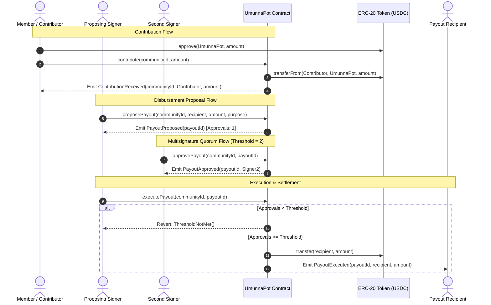
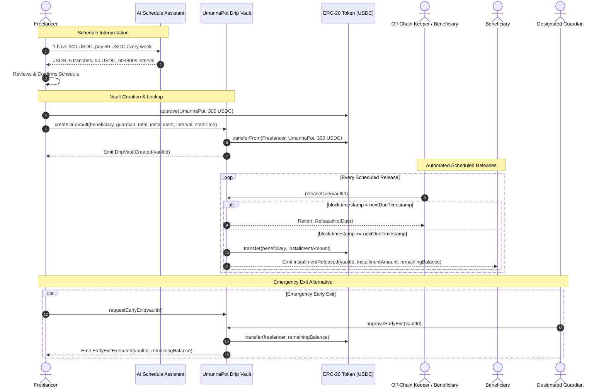

# Umunna Pot

> Programmable community finance, multisignature governed disbursements, and automated income smoothing powered by smart contracts and real-world payment infrastructure.

[](https://nextjs.org/)
[](https://react.dev/)
[](https://tailwindcss.com/)
[](https://www.typescriptlang.org/)
[-0052FF?style=flat-square&logo=coinbase>)](https://base.org)
[](LICENSE)

---

## Table of Contents

- [1. Executive Summary](#1-executive-summary)
- [2. Problem Statement](#2-problem-statement)
- [3. Core Product Modules](#3-core-product-modules)
  - [Module 1: Community Fund](#module-1-community-fund)
  - [Module 2: Community Disperse (Multisig Governance)](#module-2-community-disperse-multisig-governance)
  - [Module 3: Freelancer Drip Vault](#module-3-freelancer-drip-vault)
- [4. System Architecture & Diagrams](#4-system-architecture--diagrams)
  - [System Architecture Overview](#system-architecture-overview)
  - [Community Contribution & Disbursement Lifecycle](#community-contribution--disbursement-lifecycle)
  - [Freelancer Drip Vault Lifecycle](#freelancer-drip-vault-lifecycle)
- [5. Roqqu API Services Integration](#5-roqqu-api-services-integration)
  - [Integration Pillars](#integration-pillars)
  - [Implementation & Verification Status](#implementation--verification-status)
  - [Security Boundaries & Credential Isolation](#security-boundaries--credential-isolation)
- [6. AI Integration: Drip Schedule Assistant](#6-ai-integration-drip-schedule-assistant)
- [7. Smart-Contract Architecture](#7-smart-contract-architecture)
  - [Contract Responsibilities](#contract-responsibilities)
  - [Security Controls & Custody Rules](#security-controls--custody-rules)
- [8. Technology Stack](#8-technology-stack)
- [9. User Journeys](#9-user-journeys)
- [10. Repository Structure](#10-repository-structure)
  - [Current Directory Layout](#current-directory-layout)
  - [Planned Directories](#planned-directories)
- [11. Getting Started](#11-getting-started)
  - [Prerequisites](#prerequisites)
  - [Installation](#installation)
  - [Environment Variables](#environment-variables)
  - [Development Scripts](#development-scripts)
  - [Smart Contract Testing](#smart-contract-testing)
- [12. Development Roadmap](#12-development-roadmap)
- [13. Security, Guardrails & Limitations](#13-security-guardrails--limitations)
- [14. Contribution & Team Workflow](#14-contribution--team-workflow)
- [15. License](#15-license)

---

## 1. Executive Summary

**Umunna Pot** is a programmable-money community finance platform engineered to pool capital, enforce collective disbursement rules, and automate scheduled payouts. Rooted in the traditional West African concept of communal stewardship (_Umunna_), the platform replaces informal, error-prone treasury management with transparent, deterministic smart contracts on [Base Sepolia](https://base.org) and bridges them to real-world financial rails via [Roqqu API Services](https://service.roqqu.com/v1).

### Core Product Principle

> **Trust through programmable verification, not unilateral discretion.**  
> Rather than relying on a single custodian, opaque spreadsheets, or ad-hoc messaging group agreements, Umunna Pot embeds financial rules, approval quorums, and release timetables directly into decentralized smart contracts.

### Target Audiences

- **Family & Community Associations:** Pool dues and welfare funds with multi-signer approval.
- **Town Unions & Cultural Cooperatives:** Manage regional development contributions transparently.
- **Community Savings Groups (Esusu / Ajo):** Track transparent on-chain balances and payouts.
- **Freelancers & Remote Workers:** Smooth volatile lump-sum income into weekly or monthly releases.
- **Donation & Grant Committees:** Require verified multisignature quorums before releasing project capital.

---

## 2. Problem Statement

### A. Community Financial Trust Deficit

Many grassroots communities and associations organize contributions through spreadsheets, informal ledger apps, and chat groups. This model introduces critical vulnerabilities:

- **Opacity:** Members lack real-time visibility into actual bank account balances and cash flows.
- **Single-Point-of-Failure Custodianship:** Communal funds frequently sit in personal bank accounts of a single treasurer or chairman, creating misappropriation risks.
- **Disputed Records:** Manual record-keeping leads to reconciliation disputes over who paid, when, and how much.
- **Lack of Enforcement:** Informal promises cannot programmatically block unauthorized withdrawals.

### B. Unchecked Community Disbursements

Disbursing communal funds often triggers internal conflict when payout decisions lack transparent authorization:

- A single executive should never possess unilateral authority to disburse communal savings.
- Communities require **configurable approval thresholds** (e.g., 2-of-3 or 3-of-5 signers).
- Every disbursement request must carry a verifiable audit trail (recipient address, token amount, purpose, timestamp, and cryptographic signatures).

### C. Freelancer Income Volatility & Lack of Discipline

Independent contractors and gig workers often receive large, irregular lump-sum retainers or project milestone payouts. Without automated structure:

- Lump-sum earnings are rapidly depleted, creating personal cash-flow crises between gigs.
- Existing banking platforms offer limited automated time-locked release vaults with emergency escape hatches.
- Workers need automated cash-flow smoothing that dispenses scheduled installments to designated beneficiaries while reserving emergency exit authority for trusted guardians.

### D. Web3 Payment Accessibility Hurdles

Traditional decentralized applications (dApps) demand self-custody wallet setups, private key management, and native gas token acquisition, presenting steep onboarding friction for non-technical community members. Integrating verified on-ramp/off-ramp rails (such as Roqqu API Services) enables seamless local currency (NGN) contributions while settling on-chain.

---

## 3. Core Product Modules

```
┌────────────────────────────────────────────────────────────────────────┐
│                              UMUNNA POT                                │
├──────────────────────────┬─────────────────────────┬───────────────────┤
│    1. COMMUNITY FUND     │  2. COMMUNITY DISPERSE  │ 3. FREELANCER DRIP│
│   (Pooled Treasuries)    │   (Multisig Payouts)    │      VAULT        │
├──────────────────────────┼─────────────────────────┼───────────────────┤
│ • Shared communal pots   │ • Multisig proposals    │ • Time-locked drip│
│ • Transparent tracking   │ • M-of-N threshold check│ • Config intervals│
│ • ERC-20 token custody   │ • On-chain enforcement  │ • Keeper automated│
│ • Contribution history   │ • Immutable audit trail │ • Guardian exit   │
└──────────────────────────┴─────────────────────────┴───────────────────┘
```

### Module 1: Community Fund

The **Community Fund** module enables groups to instantiate isolated on-chain treasuries.

- Communities register with designated metadata, eligible member registries, and accepted contribution assets (e.g., MockUSDC / USDC).
- Members contribute directly using their connected Web3 wallets or via verified payment links.
- The smart contract maintains balances on-chain, rendering all deposits publicly verifiable on the block explorer.

### Module 2: Community Disperse (Multisig Governance)

The **Community Disperse** module is the disbursement and governance layer of Community Fund.

- **Proposal Lifecycle:** Any authorized member or designated officer initiates a disbursement request detailing the recipient address, token amount, and description/purpose.
- **Multisig Verification:** Configured signers (e.g., 2-of-3 threshold) must explicitly sign an on-chain transaction to approve the proposal.
- **Deterministic Enforcement:** Payout execution calls fail if the required signature threshold is not reached. Once approved, the smart contract transfers tokens directly from the treasury to the recipient.
- **No Backend Bypass:** Approval thresholds are verified exclusively within the smart contract bytecode—application server logic cannot force a payout.

### Module 3: Freelancer Drip Vault

The **Freelancer Drip Vault** is a personal income-smoothing and scheduled payout vault.

> **Note:** This module is **not** a milestone escrow and **not** a client dispute system. It is a self-directed liquidity-pacing vault for income earners.

#### How It Operates

1. **Vault Configuration:** The user deposits a lump sum of tokens, sets an installment amount, chooses a release frequency (e.g., weekly), specifies a start date, and designates a beneficiary.
2. **Guardian Assignment:** The user assigns a trusted third-party guardian address who can authorize an early emergency withdrawal if needed.
3. **Time-Locked Execution:** Capital is locked in the contract. Once each scheduled interval elapses, an off-chain keeper or beneficiary calls the release function.
4. **Contract Validation:** The smart contract validates `block.timestamp >= nextReleaseTimestamp`. Releases cannot be accelerated without guardian consent.

#### Concrete Drip Vault Example

| Parameter              | Value                | Details                                       |
| :--------------------- | :------------------- | :-------------------------------------------- |
| **Total Deposited**    | `300 USDC`           | Total lump sum locked into the vault contract |
| **Instalment Amount**  | `50 USDC`            | Amount released per payment interval          |
| **Release Frequency**  | `Weekly (604,800 s)` | Minimum duration between successive releases  |
| **Total Installments** | `6 releases`         | Calculated as `300 / 50 = 6` equal tranches   |
| **Beneficiary**        | `0xBeneficiary...`   | Recipient address receiving each tranche      |
| **Guardian**           | `0xGuardian...`      | Entity authorized to approve early exit       |

---

## 4. System Architecture & Diagrams

### System Architecture Overview

The following diagram illustrates the interaction between end users, the Next.js frontend, backend API microservices, external payment and AI providers, and the Base Sepolia blockchain:

```mermaid
flowchart TD
    subgraph Users["User Layer"]
        U1["Community Members & Contributors"]
        U2["Community Multisig Signers"]
        U3["Freelancers / Vault Creators"]
        U4["Fiat / NGN Payers (External)"]
    end

    subgraph Frontend["Frontend Layer (Next.js 16 App Router)"]
        UI1["Community Dashboard & Funds"]
        UI2["Disbursement Proposal & Voting Interface"]
        UI3["Drip Vault Manager & Schedule Preview"]
        UI4["AI Natural Language Prompt Assistant"]
        Web3Provider["Wallet Provider (Wagmi v2 / Viem / RainbowKit)"]
    end

    subgraph Backend["Backend & Integration Layer (Planned / API Routes)"]
        API["Next.js Route Handlers (/api)"]
        RoqquAdapter["Roqqu API Gateway Client"]
        WebhookHandler["Roqqu Webhook Reconciler"]
        AIEngine["AI Schedule Parser (Structured Output)"]
        Keeper["Automated Release Keeper Bot"]
    end

    subgraph External["External Infrastructure"]
        RoqquAPI["Roqqu API Services (service.roqqu.com/v1)"]
        LLM["AI Provider (Gemini / OpenAI API)"]
    end

    subgraph Blockchain["Base Sepolia Blockchain (Chain ID 84532)"]
        PotContract["UmunnaPot.sol (Treasury & Vault Contract)"]
        TokenContract["MockUSDC / ERC-20 Token"]
    end

    %% Direct On-Chain Path
    U1 -->|Connect Wallet| Web3Provider
    U2 -->|Approve & Execute| Web3Provider
    U3 -->|Deposit & Configure| Web3Provider
    Web3Provider -->|Direct Contract Calls| PotContract
    PotContract <-->|Custody & Transfers| TokenContract

    %% Backend Mediated Flows
    U4 -->|Fiat Payment / Webhook| RoqquAPI
    RoqquAPI -->|Payment Notification| WebhookHandler
    WebhookHandler --> API
    API --> RoqquAdapter
    RoqquAdapter --> RoqquAPI

    %% AI Assistance
    UI4 -->|Natural Language Prompt| API
    API --> AIEngine
    AIEngine --> LLM
    LLM -->|Validated Schedule JSON| UI3

    %% Keeper Trigger
    Keeper -->|Trigger releaseDue() when timestamp elapsed| PotContract
```

---

### Community Contribution & Disbursement Lifecycle



---

### Freelancer Drip Vault Lifecycle



---

## 5. Roqqu API Services Integration

Roqqu API Services (RAS) provides the infrastructure to link local fiat liquidity (NGN) with cryptocurrency settlement.

- **Base URL:** `https://service.roqqu.com/v1`

### Integration Pillars

#### A. Payment Inflow

- **Payment Link Generation:** Generate hosted checkout links for fiat contributors.
- **Dynamic Wallet Generation:** Assign unique deposit addresses to correlate off-chain transfers to specific community funds.
- **Webhook Reconciliation:** Ingest payment notifications, verify cryptographic signatures, and coordinate on-chain treasury accounting.
- **Asset Normalization (Swap):** Convert incoming supported assets into the platform’s standard operating asset (e.g., USDC).

#### B. Live Market Data

- **Fiat Rates:** Query real-time fiat exchange rates (e.g., USD/NGN).
- **Crypto Prices:** Retrieve live token valuations to display accurate fiat conversions inside the dashboard.
- **Crypto Balances:** Verify custodial deposit wallet reserves.

#### C. Last-Mile Settlement

- **On-Chain Verification:** Correlate on-chain execution transaction hashes with payout intents.
- **Roqqu Sell (Off-Ramp):** Convert crypto payouts to local fiat for off-chain beneficiaries.
- **Roqqu Send Coin:** Initiate external token transfers across supported public networks.

---

### Implementation & Verification Status

To ensure engineering rigor, the following matrix distinguishes verified working components from planned integrations:

| Capability / Endpoint             | Target Architecture Role         | Status in Codebase | Technical Limitation / Verification Note                                                                                                                            |
| :-------------------------------- | :------------------------------- | :----------------- | :------------------------------------------------------------------------------------------------------------------------------------------------------------------ |
| **`GET /fiat/rates`**             | Live NGN / USD valuation         | **Planned**        | Scoped in architecture; adapter client not yet committed to repo.                                                                                                   |
| **`POST /payment/link`**          | Web2 member fiat contribution    | **Planned**        | Scoped; requires Roqqu merchant account & webhook listener.                                                                                                         |
| **`POST /wallet/create`**         | Virtual deposit address per fund | **Planned**        | Scoped in design document; awaiting API adapter implementation.                                                                                                     |
| **`POST /swap`**                  | Inflow token normalization       | **Planned**        | Subject to Roqqu supported currency pairs.                                                                                                                          |
| **`POST /sell`**                  | Crypto-to-fiat last-mile payout  | **Planned**        | Requires KYC-cleared merchant credentials and recipient bank rails.                                                                                                 |
| **Base Sepolia Contract Signing** | Arbitrary smart contract calls   | **Not Supported**  | **Architectural reality:** Roqqu API does not sign custom EVM contract calls on Base Sepolia. All contract executions occur via user wallets or custom keeper bots. |

---

### Security Boundaries & Credential Isolation

- **Zero Client-Side Exposure:** Roqqu API keys (`ROQQU_SECRET_KEY`, `ROQQU_PUBLIC_KEY`) must strictly reside in server-side environment variables (`.env.local`). Never expose them in browser bundles with `NEXT_PUBLIC_` prefixes.
- **Webhook Authenticity:** All incoming webhooks must be verified using the Roqqu secret signature header before any database or contract state is updated.
- **Idempotent Processing:** Webhook events must log idempotency keys to prevent double-crediting treasury contributions.

---

## 6. AI Integration: Drip Schedule Assistant

The **AI Drip Schedule Assistant** translates unstructured natural-language requests into deterministic vault schedules.

### Workflow

When a user inputs:

> _"I have 300 USDC and want 50 USDC released every week starting next Monday."_

The assistant parses the input and generates structured, schema-compliant JSON:

```json
{
  "totalAmount": "300000000",
  "installmentAmount": "50000000",
  "intervalSeconds": 604800,
  "installmentCount": 6,
  "startDate": "2026-11-09T00:00:00Z",
  "tokenSymbol": "USDC",
  "tokenDecimals": 6
}
```

### Non-Custodial Security Boundary

> [!IMPORTANT]
> The AI assistant is an **advisory tool only**.
>
> - It **never** signs blockchain transactions.
> - It **never** accesses private keys or initiates ERC-20 token allowances.
> - It **cannot** bypass contract timelocks, signer thresholds, or guardian requirements.
> - The user must explicitly inspect the generated schedule preview in the UI and execute the deposit transaction using their connected Web3 wallet.

---

## 7. Smart-Contract Architecture

### Contract Responsibilities

The planned smart-contract architecture centers on `UmunnaPot.sol`, deployed on Base Sepolia:

```
                       ┌───────────────────────┐
                       │     UmunnaPot.sol     │
                       └───────────┬───────────┘
            ┌──────────────────────┴──────────────────────┐
            ▼                                             ▼
┌───────────────────────────────┐             ┌───────────────────────────────┐
│     Community Governance      │             │      Freelancer Drip Vault    │
├───────────────────────────────┤             ├───────────────────────────────┤
│ • createCommunity()           │             │ • createDripVault()           │
│ • contribute()                │             │ • releaseDue()                │
│ • proposePayout()             │             │ • requestEarlyExit()          │
│ • approvePayout()             │             │ • approveEarlyExit()          │
│ • executePayout()             │             └───────────────────────────────┘
└───────────────────────────────┘
```

#### Community Treasury & Governance

- `createCommunity(address[] memory signers, uint256 threshold)`: Deploys a new communal treasury with an M-of-N signature requirement.
- `contribute(uint256 communityId, uint256 amount)`: Pulls ERC-20 tokens into the contract and credits the community's treasury ledger.
- `proposePayout(uint256 communityId, address recipient, uint256 amount, string memory purpose)`: Creates an on-chain payout proposal.
- `approvePayout(uint256 communityId, uint256 payoutId)`: Records a signer's approval. Reverts if the caller is not an authorized signer.
- `executePayout(uint256 communityId, uint256 payoutId)`: Validates that `approvals >= threshold` and transfers tokens to the recipient.

#### Freelancer Drip Vault

- `createDripVault(address beneficiary, address guardian, uint256 totalAmount, uint256 installment, uint256 interval, uint256 startTime)`: Locks tokens and initiates the release timeline.
- `releaseDue(uint256 vaultId)`: Verifies `block.timestamp >= nextReleaseTimestamp` and releases one installment to the beneficiary.
- `requestEarlyExit(uint256 vaultId)`: Initiates a premature vault termination request by the owner.
- `approveEarlyExit(uint256 vaultId)`: Executed by the designated guardian to release all remaining locked funds back to the creator.

### Security Controls & Custody Rules

1. **Reentrancy Protection:** All state-modifying withdrawal functions implement `ReentrancyGuard` and follow the _Checks-Effects-Interactions_ pattern.
2. **Safe ERC-20 Handling:** Token transfers use OpenZeppelin's `SafeERC20` wrapper to prevent silent transfer failures.
3. **Decentralized Execution:** The `releaseDue` function is publicly callable—allowing off-chain keeper bots, beneficiaries, or creators to trigger due releases without centralized permission.
4. **Time Invariance:** Payout due dates rely on contract storage timestamps and block times; backend services cannot falsify release availability.

---

## 8. Technology Stack

### Current Repository Dependencies

The repository is currently initialized as a modern Next.js web application:

| Category            | Technology                                    | Version              | Purpose                                                  |
| :------------------ | :-------------------------------------------- | :------------------- | :------------------------------------------------------- |
| **Framework**       | [Next.js](https://nextjs.org/) (App Router)   | `16.4.3`             | Full-stack server and UI architecture                    |
| **UI Library**      | [React](https://react.dev/)                   | `19.3.1`             | Declarative component hierarchy                          |
| **Styling**         | [Tailwind CSS](https://tailwindcss.com/)      | `v4.0.0`             | Utility-first styling engine with `@tailwindcss/postcss` |
| **Primitives**      | [@base-ui/react](https://base-ui.com/)        | `^1.9.0`             | Accessible unstyled interface foundations                |
| **Components**      | [shadcn/ui](https://ui.shadcn.com/)           | `^4.23.0`            | Component templates (`base-nova` preset)                 |
| **Icons**           | [Lucide React](https://lucide.dev/)           | `^1.68.0`            | Scalable system iconography                              |
| **Type Safety**     | [TypeScript](https://www.typescriptlang.org/) | `^5.0.0`             | Static compile-time type verification                    |
| **Code Quality**    | ESLint & Prettier                             | `^9.0.0` / `^3.9.10` | Static analysis and opinionated code formatting          |
| **Package Manager** | [pnpm](https://pnpm.io/)                      | Workspace ready      | Deterministic dependency resolution                      |

### Planned / Target Architecture Stack

The following dependencies and tools are scoped for implementation across upcoming phases:

| Category              | Technology                                            | Target Version   | Architectural Role                                              |
| :-------------------- | :---------------------------------------------------- | :--------------- | :-------------------------------------------------------------- |
| **Smart Contracts**   | [Solidity](https://soliditylang.org/)                 | `^0.8.20`        | Core logic for treasuries, multisig, and drip vaults            |
| **Contract Tooling**  | [Foundry](https://book.getfoundry.sh/)                | Latest           | Compilation, testing, fuzzing, and Base Sepolia deployment      |
| **Contract Library**  | [OpenZeppelin](https://openzeppelin.com/)             | `v5.x`           | Industry-standard `SafeERC20`, `ReentrancyGuard`, and `Ownable` |
| **Web3 Client**       | [Wagmi](https://wagmi.sh/) & [Viem](https://viem.sh/) | `v2.x`           | Type-safe Ethereum hooks and low-level blockchain primitives    |
| **Wallet Onboarding** | [RainbowKit](https://www.rainbowkit.com/)             | `v2.x`           | Multi-wallet connection interface                               |
| **Target Network**    | [Base Sepolia](https://base.org)                      | Chain ID `84532` | Low-cost, high-throughput Layer 2 execution environment         |
| **Payment Gateway**   | [Roqqu API Services](https://service.roqqu.com/v1)    | `v1`             | Fiat on-ramp, rates, and settlement rails                       |
| **AI Parsing**        | Google Gemini / OpenAI SDK                            | Latest           | Natural language extraction of structured schedule schemas      |

---

## 9. User Journeys

### Journey A: Community Fund Creation & Pooling

1. **Connect Wallet:** The community administrator connects their Web3 wallet.
2. **Configure Fund:** The admin specifies the community name, selects accepted tokens, adds signer addresses, and defines the approval threshold (e.g., 2-of-3).
3. **Deploy:** The community is registered on-chain via `createCommunity`.
4. **Contribute:** Members navigate to the community page, approve the token spend, and deposit funds via `contribute`.
5. **Monitor:** Real-time on-chain balances, member contribution logs, and total pooled reserves update dynamically on the dashboard.

### Journey B: Community Disperse (Multisig Governance)

1. **Draft Proposal:** An authorized officer submits a payout proposal (recipient address, amount, purpose).
2. **Notify Signers:** The dashboard surfaces pending proposals to designated signers.
3. **Collect Approvals:** Signers connect their wallets and execute `approvePayout` on-chain.
4. **Execution:** Once the approval count meets the threshold, the `executePayout` transaction transfers tokens to the recipient.
5. **Reconciliation:** The proposal status updates to _Executed_, linking directly to the Base Sepolia block explorer.

### Journey C: Freelancer Drip Vault

1. **Define Schedule:** The freelancer enters parameters manually or describes their payout goal using the AI Assistant prompt.
2. **Preview & Confirm:** The user reviews installment counts, dates, and amounts in the schedule preview.
3. **Deposit:** The user approves and calls `createDripVault`, locking funds into the contract.
4. **Automated Release:** Each time the interval passes, the keeper bot or beneficiary executes `releaseDue`.
5. **Emergency Exit:** If unexpected cash needs arise, the freelancer requests an early exit, which releases all remaining funds upon guardian approval.

### Journey D: Roqqu Fiat/Crypto On-Ramp _(Planned)_

1. **Select Local Currency:** An off-chain member chooses to contribute in Nigerian Naira (NGN).
2. **Generate Payment Link:** The backend requests a dynamic checkout link from Roqqu API Services.
3. **Fulfill Payment:** The member completes the transfer via local bank rails or debit card.
4. **Webhook Processing:** Roqqu notifies the Umunna Pot backend; the transaction signature is verified.
5. **Treasury Credit:** The backend normalizes the funds and registers the member's contribution.

---

## 10. Repository Structure

### Current Directory Layout

The physical repository reflects an initialized Next.js 16 application with shadcn/ui and Tailwind CSS v4:

```
umunna-pot/
├── app/
│   ├── favicon.ico             # Application favicon
│   ├── globals.css             # Tailwind CSS v4 directives & theme variables
│   ├── layout.tsx              # Root HTML wrapper with theme provider & fonts
│   └── page.tsx                # Initial landing page & UI verification
├── components/
│   ├── ui/
│   │   └── button.tsx          # Initial shadcn/ui Button primitive
│   ├── theme-provider.tsx      # Dark/light mode theme wrapper (next-themes)
│   └── .gitkeep
├── hooks/
│   └── .gitkeep                # Directory for custom React & Web3 hooks
├── lib/
│   ├── utils.ts                # Tailwind class merging utility (cn helper)
│   └── .gitkeep                # Directory for utility functions & clients
├── public/
│   └── .gitkeep                # Static public assets
├── .gitignore                  # Git exclusion rules (includes Foundry patterns)
├── .prettierignore             # Prettier exclusion patterns
├── .prettierrc                 # Opinionated formatting configuration
├── AGENTS.md                   # Agent guidelines & Next.js documentation rules
├── CLAUDE.md                   # Project agent pointer
├── components.json             # shadcn/ui CLI configuration (base-nova preset)
├── eslint.config.mjs           # ESLint v9 flat configuration
├── LICENSE                     # MIT License
├── next.config.ts              # Next.js compiler and runtime configuration
├── package.json                # Project dependencies and operational scripts
├── pnpm-lock.yaml              # Deterministic pnpm dependency lockfile
├── pnpm-workspace.yaml         # pnpm workspace configuration
├── postcss.config.mjs          # PostCSS configuration for Tailwind CSS v4
├── README.md                   # Project master documentation (this file)
└── tsconfig.json               # TypeScript compiler options
```

### Planned Directories

As development progresses through the roadmap phases, the following directory modules will be introduced:

- `contracts/`: Foundry smart-contract workspace containing `src/UmunnaPot.sol`, `src/MockUSDC.sol`, deployment scripts (`script/`), and comprehensive Foundry test suites (`test/`).
- `app/api/`: Server-side API route handlers for Roqqu webhooks, live exchange-rate caching, and AI schedule processing.
- `lib/roqqu/`: Typed client adapter, cryptographic webhook verification helpers, and rate retrieval services.
- `lib/contracts/`: Smart contract ABIs, deployed contract address registries, and custom Wagmi read/write hooks.

---

## 11. Getting Started

### Prerequisites

Ensure the following tools are installed on your machine:

- [Node.js](https://nodejs.org/) `>= 20.18.0`
- [pnpm](https://pnpm.io/) `>= 9.0.0`
- [Git](https://git-scm.com/)
- _(Optional for Smart Contract Development)_ [Foundry](https://getfoundry.sh/) (`forge`, `cast`, `anvil`)

### Installation

1. **Clone the repository:**

   ```bash
   git clone https://github.com/Umunna-Pot/umunna-pot.git
   cd umunna-pot
   ```

2. **Install project dependencies:**
   ```bash
   pnpm install
   ```

### Environment Variables

Create a `.env.local` file in the root directory. Configure the following variables for local development:

```bash
# App Configuration
NEXT_PUBLIC_APP_URL="http://localhost:3000"

# Blockchain Configuration (Base Sepolia)
NEXT_PUBLIC_CHAIN_ID="84532"
NEXT_PUBLIC_RPC_URL="https://sepolia.base.org"
NEXT_PUBLIC_POT_CONTRACT_ADDRESS="0x0000000000000000000000000000000000000000"
NEXT_PUBLIC_TOKEN_ADDRESS="0x0000000000000000000000000000000000000000"

# Web3 Wallet Configuration
NEXT_PUBLIC_WALLETCONNECT_PROJECT_ID="your_walletconnect_project_id"

# Roqqu API Services (Server-Side Only - NEVER expose with NEXT_PUBLIC_)
ROQQU_BASE_URL="https://service.roqqu.com/v1"
ROQQU_PUBLIC_KEY="your_roqqu_public_key"
ROQQU_SECRET_KEY="your_roqqu_secret_key"
ROQQU_WEBHOOK_SECRET="your_roqqu_webhook_signing_secret"

# AI Integration
AI_PROVIDER_API_KEY="your_ai_api_key"
```

> [!CAUTION]
> Never commit `.env.local` or any file containing private keys or API secrets to version control.

### Development Scripts

The following scripts are defined in `package.json`:

```bash
# Start local development server (http://localhost:3000)
pnpm dev

# Perform static type checking across TypeScript source files
pnpm run typecheck

# Run ESLint to identify code quality issues
pnpm run lint

# Format code with Prettier and Tailwind CSS class sorter
pnpm run format

# Compile optimized production build
pnpm run build

# Start production server
pnpm start
```

### Smart Contract Testing

When the smart contract module is populated in `contracts/`, run tests using Foundry:

```bash
# Run unit tests and invariant checks
forge test

# Run tests with detailed execution traces
forge test -vvvv

# Deploy to Base Sepolia
forge script script/DeployUmunnaPot.s.sol --rpc-url $BASE_SEPOLIA_RPC_URL --broadcast --verify
```

---

## 12. Development Roadmap

The development of Umunna Pot is structured into five distinct phases. Below is the current audit status:

```
┌────────────────────────────────────────────────────────────────────────┐
│                        PROJECT ROADMAP STATUS                          │
├─────────┬───────────────────────────────────────────┬──────────────────┤
│ Phase   │ Description                               │ Status           │
├─────────┼───────────────────────────────────────────┼──────────────────┤
│ Phase 1 │ Foundation & Scaffolding                  │ 🔄 In Progress   │
│ Phase 2 │ Community Finance (Treasury & Multisig)   │ ⏳ Planned       │
│ Phase 3 │ Drip Vault & AI Integration               │ ⏳ Planned       │
│ Phase 4 │ Quality Assurance & Security Hardening    │ ⏳ Planned       │
│ Phase 5 │ Demo Environment & Hackathon Submission   │ ⏳ Planned       │
└─────────┴───────────────────────────────────────────┴──────────────────┘
```

### Phase 1 — Foundation and Scaffolding

- [x] Repository initialized with Next.js 16 (App Router), React 19, and Tailwind CSS v4.
- [x] UI component library set up with shadcn/ui (`base-nova` preset) and theme providers.
- [x] TypeScript compiler and ESLint configurations validated.
- [ ] Install Web3 dependencies (`wagmi`, `viem`, `@rainbow-me/rainbowkit`).
- [ ] Initialize Foundry contracts directory and write `UmunnaPot.sol` interface.
- [ ] Establish Roqqu API client adapter and environment configuration.

### Phase 2 — Community Finance

- [ ] Implement `UmunnaPot.sol` Community Fund logic (deposit, accounting, events).
- [ ] Implement on-chain multisig disbursement (`proposePayout`, `approvePayout`, `executePayout`).
- [ ] Write Foundry test suite covering threshold enforcement and unauthorized call reverts.
- [ ] Deploy contract to Base Sepolia testnet and verify on block explorer.
- [ ] Build Community Fund dashboard and proposal review interface in Next.js.

### Phase 3 — Drip Vault and AI

- [ ] Implement `UmunnaPot.sol` Freelancer Drip Vault logic with time-locked releases.
- [ ] Implement guardian emergency exit authorization flow.
- [ ] Develop AI schedule parser endpoint using structured LLM outputs.
- [ ] Build interactive schedule preview UI with milestone dates and installment breakdowns.
- [ ] Configure automated keeper script to trigger `releaseDue` for mature tranches.

### Phase 4 — Integration and Quality Assurance

- [ ] Multi-wallet testing (Coinbase Wallet, MetaMask, Rainbow) across signer workflows.
- [ ] End-to-end integration testing for contribution, multisig payout, and drip vault releases.
- [ ] Roqqu payment link creation and webhook reconciliation testing.
- [ ] Security audit: Reentrancy checks, gas optimizations, and input sanitization.
- [ ] Transaction explorer linking and comprehensive loading/error state coverage.

### Phase 5 — Release and Presentation

- [ ] Seed live demo communities and active drip vaults on Base Sepolia.
- [ ] Finalize UI polish, mobile responsiveness, and dark/light mode parity.
- [ ] Record end-to-end walkthrough and backup demonstration video.
- [ ] Complete technical documentation, pitch deck, and official submission.

---

## 13. Security, Guardrails & Limitations

- **On-Chain Financial Authority:** Smart contracts enforce all deposit locks, multisig quorums, and release intervals. Application backends cannot override contract rules.
- **Non-Custodial Design:** Umunna Pot never takes custody of user private keys. All blockchain interactions require explicit user authorization via Web3 wallets.
- **Keeper Constraints:** Off-chain keeper bots can only trigger due releases. They cannot redirect funds, alter installment amounts, or accelerate releases before scheduled timestamps.
- **AI Sandboxing:** The AI Assistant operates strictly as a text-parsing helper. It possesses no wallet credentials, cannot sign transactions, and cannot approve allowances.
- **Webhook Signature Verification:** All Roqqu webhook payloads must be cryptographically authenticated using HMAC signatures before processing.
- **Token Decimals Precision:** All calculations handle token decimals explicitly (e.g., USDC uses 6 decimals: `1 USDC = 1,000,000` base units).
- **Testnet & Hackathon Disclaimer:** This repository represents active hackathon software deployed on testnets (Base Sepolia). It is not audited for production deployment or real-value mainnet capital.

---

## 14. Contribution & Team Workflow

1. **Clone the Organization Repository:**

   ```bash
   git clone https://github.com/Umunna-Pot/umunna-pot.git
   cd umunna-pot
   ```

2. **Synchronize Main:**

   ```bash
   git checkout main
   git pull origin main
   ```

3. **Create a Feature Branch:**

   ```bash
   git checkout -b feat/your-feature-name
   # or
   git checkout -b fix/your-bugfix-name
   ```

4. **Verify Quality Standards Before Committing:**

   ```bash
   pnpm run typecheck
   pnpm run lint
   pnpm run format
   ```

5. **Submit a Pull Request:**
   - Push your branch to `origin`.
   - Open a Pull Request targeting `main`.
   - Provide a clear summary of changes, linked issues, and verification steps.
   - Obtain peer review approval before merging.

---

## 15. License

This project is licensed under the [MIT License](LICENSE) - see the LICENSE file for details.

---

_Built with precision for the Umunna Pot community finance ecosystem._
