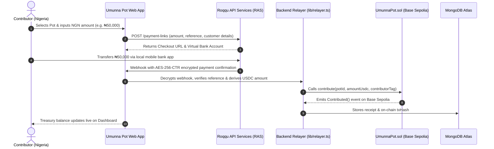
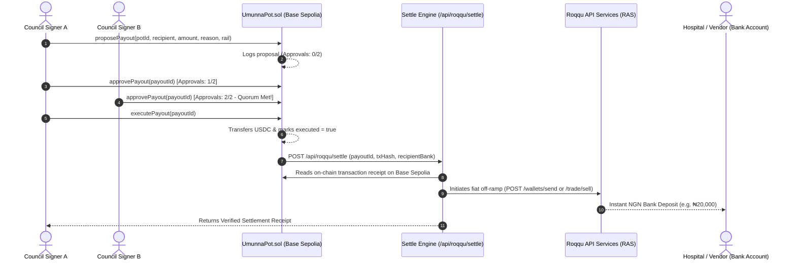
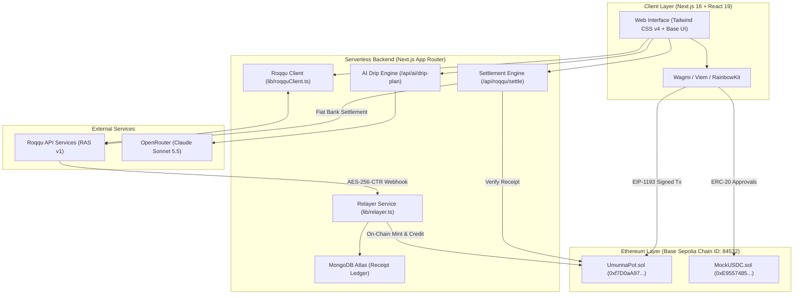

# Umunna Pot

> Programmable community finance, multisignature governed disbursements, and automated income smoothing powered by Ethereum smart contracts and Roqqu payment infrastructure.

[](https://nextjs.org/)
[](https://react.dev/)
[](https://tailwindcss.com/)
[](https://www.typescriptlang.org/)
[-0052FF?style=flat-square&logo=coinbase)](https://base.org)
[](https://roqqu.com)
[](https://www.mongodb.com/)
[-purple?style=flat-square)](https://openrouter.ai/)
[](LICENSE)

---

## Table of Contents

- [1. Executive Summary & Overview](#1-executive-summary--overview)
- [2. The Real-World Problem & Value Proposition](#2-the-real-world-problem--value-proposition)
- [3. Core Product Modules](#3-core-product-modules)
  - [Module 1: Community Fund (Pooling)](#module-1-community-fund-pooling)
  - [Module 2: Governed Disbursements (Multisig Quorum)](#module-2-governed-disbursements-multisig-quorum)
  - [Module 3: Freelancer Drip Vault (Streaming Payroll)](#module-3-freelancer-drip-vault-streaming-payroll)
- [4. The Roqqu × Ethereum Hybrid Architecture](#4-the-roqqu--ethereum-hybrid-architecture)
  - [Inflow Bridge: Fiat NGN → On-Chain Smart Contract](#inflow-bridge-fiat-ngn--on-chain-smart-contract)
  - [Outflow Bridge: Multisig Quorum → Fiat Bank Settlement](#outflow-bridge-multisig-quorum--fiat-bank-settlement)
  - [Roqqu API Services (RAS) Stack](#roqqu-api-services-ras-stack)
- [5. Ethereum Smart Contracts (UmunnaPot.sol) Deep Dive](#5-ethereum-smart-contracts-umunnapotsol-deep-dive)
  - [Contract Responsibilities & Architecture](#contract-responsibilities--architecture)
  - [Multisig Quorum Security Invariants](#multisig-quorum-security-invariants)
  - [Freelancer Drip Vault Timelocks & Emergency Unlock](#freelancer-drip-vault-timelocks--emergency-unlock)
- [6. AI Schedule Recommendation Engine](#6-ai-schedule-recommendation-engine)
- [7. Complete System Architecture & Data Flow](#7-complete-system-architecture--data-flow)
- [8. Deployed Smart Contracts & Networks](#8-deployed-smart-contracts--networks)
- [9. Technology Stack](#9-technology-stack)
- [10. Repository Structure](#10-repository-structure)
- [11. Getting Started & Configuration](#11-getting-started--configuration)
- [12. Testing & Verification Suites](#12-testing--verification-suites)
- [13. Security, Guardrails & Non-Custodial Invariants](#13-security-guardrails--non-custodial-invariants)
- [14. License](#14-license)

---

## 1. Executive Summary & Overview

**Umunna Pot** is a hybrid community finance platform that bridges everyday **Nigerian Naira (NGN) banking rails** with **Ethereum smart contracts on Base Sepolia**. 

Named after the Igbo concept of communal kinship and stewardship (_Umunna_), the platform brings programmable trust, multi-party signature quorums, and automated income timelocks to groups that need transparent capital management.

### Key Capabilities at a Glance:
1. **Fiat-to-Crypto On-Ramp:** Everyday members contribute via local Nigerian bank transfers using **Roqqu API Services**. Funds are automatically credited as `mUSDC` inside smart contracts on Base Sepolia.
2. **On-Chain Multi-Sig Governance:** Council leaders propose payouts, collect cryptographic approvals on-chain, and enforce strictly verifiable $M$-of-$N$ signer quorums.
3. **Crypto-to-Bank Off-Ramp:** When a disbursement proposal is approved, it can be paid to a crypto address or settled directly to a Nigerian bank account (e.g. for hospital bills or vendor fees) via Roqqu.
4. **Freelancer Drip Vaults:** Gig workers and contractors lock retainers into non-custodial streaming vaults with AI-assisted release cadences and guardian emergency unlock protection.

---

## 2. The Real-World Problem & Value Proposition

### The Problem: Informal African Treasury Management
- **Single-Treasurer Risk:** Traditional savings circles (*Esusu*, *Ajo*, town unions, alumni groups) typically pool money into a single official's personal commercial bank account. This routinely leads to misappropriation, unilateral spending, and bookkeeping distrust.
- **The Crypto Usability Gap:** Most communal members do not hold crypto wallets, cannot pay gas fees, and do not understand gas limits or token approvals.
- **Income Volatility for Freelancers:** Gig workers receiving lump sums struggle with disciplined budgeting without automated, lock-and-stream payment rails.

### How Umunna Pot Solves It:
- **Zero-Friction for Contributors:** Contributors pay in NGN using their regular mobile banking apps (GTBank, Access, OPay, etc.) via dynamic Roqqu payment links and virtual accounts.
- **Uncompromised Smart Contract Security:** The pooled capital lives securely in `UmunnaPot.sol` on Base Sepolia. Not even the pot creator can withdraw funds without meeting the on-chain multi-sig signature threshold.
- **Direct Real-World Settlement:** Disbursed funds are bridged directly to recipient bank accounts through Roqqu auto-settlement upon verified on-chain execution.

---

## 3. Core Product Modules

### Module 1: Community Fund (Pooling)
- Organizers launch a named community pot on Base Sepolia with defined multi-sig rules (e.g., 2-of-3 signers).
- Supports dual contribution rails:
  - **Direct Web3:** Deposit `mUSDC` directly using connected Ethereum wallets.
  - **Fiat Roqqu Gateway:** Pay NGN via bank transfer, converted at live rates and minted into the smart contract.

### Module 2: Governed Disbursements (Multisig Quorum)
- Authorized council signers draft formal payout requests specifying recipient, amount, category, and settlement method (Bank Account or Crypto Wallet).
- Signers approve proposals on-chain using their private keys.
- Once the threshold is met, any council member triggers `executePayout()`, which releases funds on Base Sepolia and initiates fiat bank settlement if requested.

### Module 3: Freelancer Drip Vault (Streaming Payroll)
- Contractors lock lump sums into an automated on-chain timelock stream.
- Supports Daily (24h), Weekly (7d), Monthly (30d), and Custom intervals ($\ge 30\text{s}$).
- Beneficiaries claim due tranches over time via `releaseDue()`.
- **Dual-Key Emergency Unlock:** In case of emergency, the beneficiary requests an early unlock, which unlocks remaining funds only upon cryptographic approval from their designated **Guardian**.

---

## 4. The Roqqu × Ethereum Hybrid Architecture

The centerpiece of Umunna Pot is the seamless bidirectional interaction between **Roqqu API Services (RAS)** and **Base Sepolia EVM Smart Contracts**.

### Inflow Bridge: Fiat NGN → On-Chain Smart Contract

Contributors don't need crypto wallets or ETH for gas. They pay in NGN, and the system relays the transaction onto Base Sepolia:



1. **Payment Initiation:** When a contributor enters an NGN amount, the app creates a dedicated payment link via Roqqu RAS (`POST /payment-links`).
2. **Fiat Payment:** The contributor pays using their bank app to a dynamic virtual account.
3. **Encrypted Webhook Verification:** Roqqu sends an encrypted webhook payload to `/api/roqqu/webhook`. The server decrypts it using **AES-256-CTR** with the merchant's 32-byte secret key and IV header.
4. **On-Chain Relayer Credit:** The server-side relayer (`lib/relayer.ts`) calculates the USDC amount using live Roqqu market rates, then calls `contribute()` on `UmunnaPot.sol` using its relayer key.
5. **Idempotency Guarantee:** References are cached in memory and database to ensure zero duplicate mints or deposits.

---

### Outflow Bridge: Multisig Quorum → Fiat Bank Settlement

When community funds are needed (e.g., paying a hospital bill or contractor invoice), the platform bridges on-chain consensus back into fiat banking:



1. **Proposal & Quorum:** Signers review the disbursement request on the Governed Disbursements page and sign the proposal on Base Sepolia.
2. **On-Chain Execution:** Once approvals reach the pot's threshold, `executePayout()` transfers the tokens out of the treasury.
3. **Receipt Verification:** The settlement engine (`POST /api/roqqu/settle`) fetches the transaction receipt directly from Base Sepolia using Viem to cryptographically verify that the payout was executed on-chain before initiating any fiat transfer.
4. **Instant Off-Ramp:** Roqqu API Services executes the bank transfer to the recipient's commercial Nigerian bank account.

---

### Roqqu API Services (RAS) Stack

| Roqqu RAS Capability | Endpoint / Protocol | Role in Umunna Pot |
| :--- | :--- | :--- |
| **Market Rates & Prices** | `GET /fiat/rates`<br>`GET /market/prices` | Fetches real-time NGN/USD valuation benchmarks (`₦1,375`) to calculate live treasury metrics and ensure fair fiat-to-token conversions. |
| **Payment Links (Checkout)** | `POST /payment-links` | Generates dynamic checkout links and Nigerian bank virtual accounts with embedded community metadata. |
| **Treasury Balances** | `GET /wallets/balances` | Monitors relayer liquidity in real time to guarantee sufficient balance before processing settlements. |
| **Secure Webhooks** | `POST /api/roqqu/webhook` | Receives payment notifications encrypted with **AES-256-CTR**, verified using a 32-byte secret key and IV header to block replay attacks. |
| **Settlement Rails** | `POST /wallets/send`<br>`POST /trade/sell` | Disburses off-ramp payments to external recipient crypto wallets or Nigerian commercial bank accounts. |

---

## 5. Ethereum Smart Contracts (`UmunnaPot.sol`) Deep Dive

The contract [`UmunnaPot.sol`](file:///home/legend4tech/Documents/umunna-pot/contracts/src/UmunnaPot.sol) is deployed on **Base Sepolia** at `0xf7D0aA978B6Ec7451a87Cc4457f282596a5df738`. It serves as a unified, gas-optimized engine combining two core primitives:

### Contract Responsibilities & Architecture

```
                    ┌─────────────────────────────────────────────────┐
                    │                 UmunnaPot.sol                   │
                    │      (Base Sepolia - OpenZeppelin v5)           │
                    └───────────────┬─────────────────┬───────────────┘
                                    │                 │
                ┌───────────────────┴───┐         ┌───┴───────────────────┐
                ▼                       ▼         ▼                       ▼
    ┌──────────────────────┐ ┌──────────────────┐ ┌──────────────────┐ ┌──────────────────┐
    │  Community Creation  │ │ Multisig Quorum  │ │ Freelancer Drip  │ │  Emergency Exit  │
    │  & Signer Registry   │ │  Disbursements   │ │   Timelocks      │ │ Guardian Co-Sign │
    └──────────────────────┘ └──────────────────┘ └──────────────────┘ └──────────────────┘
```

### Multisig Quorum Security Invariants
- **Dynamic $M$-of-$N$ Thresholds:** Pots can be configured with any threshold from 1-of-1 to $M$-of-$N$ (e.g. 2-of-3, 3-of-5).
- **Cryptographic Access Control:** Only registered signers for a specific pot can propose or approve disbursements (`isCommunitySigner[potId][msg.sender]`).
- **Anti-Double-Voting:** The contract tracks `hasApproved[payoutId][msg.sender]` mapping to prevent duplicate signatures.
- **Strict Execution Guard:** `executePayout()` validates that `approvalCount >= threshold`. Funds cannot be transferred without verified quorum consensus.
- **Reentrancy Protection:** All fund transfers utilize OpenZeppelin `ReentrancyGuard` and `SafeERC20` routines.

### Freelancer Drip Vault Timelocks & Emergency Unlock
- **Deterministic Cadence:** Retainers are divided into fixed installments disbursed on a strictly enforced schedule (`block.timestamp >= nextReleaseAt`).
- **Contract Interval Floor:** Enforces a minimum interval of 30 seconds (`MIN_INTERVAL_SECONDS = 30`) to prevent transaction spamming while allowing testability.
- **Two-Party Emergency Unlock:**
  1. The **Beneficiary** requests an emergency exit via `requestEarlyExit(vaultId)`.
  2. The **Guardian** (who must be a distinct address from the beneficiary) inspects the emergency request and confirms via `approveEarlyExit(vaultId)`.
  3. All remaining principal is released immediately to the beneficiary without waiting for future interval dates.

---

## 6. AI Schedule Recommendation Engine

The **AI Drip Schedule Assistant** connects users to intelligent milestone planning without introducing financial risk:

```
User Inputs (Budget, Cadence, Milestone Scope) ──► POST /api/ai/drip-plan
                                                          │
                        ┌─────────────────────────────────┴─────────────────────────────────┐
                        ▼                                                                   ▼
         OpenRouter AI (Claude Sonnet 5.5)                                     Deterministic Fallback
        (Advisory milestone cadence selection)                             (Zero-downtime offline backup)
                        │                                                                   │
                        └─────────────────────────────────┬─────────────────────────────────┘
                                                          ▼
                                       Deterministic Financial Calculator
                                        (lib/dripScheduleCalculator.ts)
                                    • BigInt 6-decimal micro-unit division
                                    • Exact remainder added to final tranche
                                    • Zero floating-point rounding errors
                                                          ▼
                                             Deterministic Vault Schedule
```

### Zero-Trust AI Guardrails:
1. **Advisory Role Only:** The AI only suggests cadence and installment counts. It never holds keys, signs transactions, or controls funds.
2. **Exact Micro-Unit Arithmetic:** All token arithmetic is computed in `BigInt` 6-decimal integer micro-units ($1\text{ USDC} = 1{,}000{,}000$ base units). Remainder pennies from division are deterministically assigned to the final tranche so $\sum \text{installments} \equiv \text{totalAmount}$.
3. **Transparent UI Attribution:** The interface explicitly badges recommendations as **AI Recommended** (with model tag) or **Deterministic Fallback**.

---

## 7. Complete System Architecture & Data Flow



---

## 8. Deployed Smart Contracts & Networks

| Contract / Asset | Network | Address | Explorer Link |
| :--- | :--- | :--- | :--- |
| **UmunnaPot** | Base Sepolia (`84532`) | `0xf7D0aA978B6Ec7451a87Cc4457f282596a5df738` | [View on BaseScan](https://sepolia.basescan.org/address/0xf7D0aA978B6Ec7451a87Cc4457f282596a5df738) |
| **MockUSDC (`mUSDC`)** | Base Sepolia (`84532`) | `0xE9557485Ccd568c3984451f04f4ceF6E5b63809a` | [View on BaseScan](https://sepolia.basescan.org/address/0xE9557485Ccd568c3984451f04f4ceF6E5b63809a) |

> [!NOTE]
> All UI screens explicitly label test assets as **`mUSDC` (MockUSDC on Base Sepolia)** to prevent confusing testnet assets with production stablecoins.

---

## 9. Technology Stack

- **Framework:** Next.js `16.4.3` (App Router, Turbopack)
- **Frontend UI:** React `19.3.1`, Tailwind CSS `v4`, Base UI, Lucide icons
- **Web3 & State:** Wagmi `v2.19.5`, Viem `v2.57.16`, RainbowKit `v2.2.11`, TanStack React Query `v5.105.3`
- **Fiat Infrastructure:** Roqqu API Services (RAS v1, AES-256-CTR Webhooks, Payment Links, Bank Settlement)
- **Smart Contracts:** Solidity `^0.8.20`, OpenZeppelin Contracts `v5`, Foundry (`forge`)
- **Database:** MongoDB Atlas with Mongoose `v9.11.4` (serverless connection pooling)
- **AI Inference:** OpenRouter API (`anthropic/claude-sonnet-5.5`)
- **Validation:** Zod `v4.6.7`

---

## 10. Repository Structure

```
umunna-pot/
├── app/
│   ├── (app)/
│   │   ├── community-funds/      # Community funds listing, creation & NGN/USDC pooling
│   │   ├── dashboard/            # Treasury overview, Quorum Governance & live Roqqu rates
│   │   ├── disbursements/        # Multisig proposals, signing & off-ramp settlements
│   │   └── drip-vault/           # Freelancer Drip Vault frontend & claim interface
│   ├── api/
│   │   ├── ai/drip-plan/         # Advisory AI schedule planner endpoint
│   │   ├── communities/          # Community pot database endpoints
│   │   ├── drip-vaults/          # Verified on-chain vault receipt ingestion
│   │   ├── payouts/              # Payout proposals & execution sync endpoints
│   │   └── roqqu/                # Rates, payment links, settlement & webhook handlers
│   ├── layout.tsx                # App root wrapper & Web3Provider
│   └── page.tsx                  # Landing page
├── components/
│   ├── community/                # Community cards, deposit modals, payout dialogs
│   ├── drip/                     # Drip vault cards, modals, AI previews, sync recovery
│   ├── shell/                    # Header, custom brand connect button, navigation
│   └── ui/                       # Base UI & Tailwind primitives (buttons, dialogs, cards)
├── hooks/
│   ├── useCommunityPots.ts       # On-chain contract reads & event synchronization
│   ├── useDashboardData.ts       # React Query hooks for treasury metrics
│   ├── useDripVault.ts           # Drip Vault creation, release & recovery hooks
│   └── useRoqquRates.ts          # Live NGN/USD valuation hooks
├── lib/
│   ├── contracts.ts              # Contract ABIs, addresses & Base Sepolia constants
│   ├── db.ts                     # MongoDB connection pooling & cache
│   ├── dripScheduleCalculator.ts # Deterministic BigInt financial calculator
│   ├── relayer.ts                # Server-side on-chain transaction bridge & receipt verification
│   └── roqquClient.ts            # Roqqu RAS client, rates, payment links & webhook decryption
├── models/
│   ├── Community.ts              # MongoDB model for community funds
│   ├── DripVault.ts              # MongoDB model for verified drip vaults
│   └── PayoutProposal.ts         # MongoDB model for multi-sig proposals & off-ramp receipts
├── contracts/                    # Foundry workspace (UmunnaPot.sol, MockUSDC.sol)
└── test/                         # Automated test suites (API, Frontend, Sync & Math)
```

---

## 11. Getting Started & Configuration

### Prerequisites
- **Node.js**: `>= 20.18.0`
- **pnpm**: `>= 9.0.0`
- **Git**

### Installation
```bash
git clone https://github.com/Umunna-Pot/umunna-pot.git
cd umunna-pot
pnpm install
```

### Environment Configuration
Copy `.env.example` to `.env.local` and configure your credentials:
```bash
cp .env.example .env.local
```

Key environment variables:
```bash
# Network & Smart Contracts
NEXT_PUBLIC_BASE_SEPOLIA_RPC_URL="https://sepolia.base.org"
NEXT_PUBLIC_CHAIN_ID="84532"
NEXT_PUBLIC_UMUNNA_POT_ADDRESS="0xf7D0aA978B6Ec7451a87Cc4457f282596a5df738"
NEXT_PUBLIC_MOCK_USDC_ADDRESS="0xE9557485Ccd568c3984451f04f4ceF6E5b63809a"

# Relayer Key (For bridging Roqqu NGN deposits onto Base Sepolia)
RELAYER_PRIVATE_KEY="0x..."

# Roqqu API Services (RAS)
ROQQU_BASE_URL="https://service.roqqu.com/v1"
ROQQU_SECRET_KEY="your_32_byte_roqqu_secret_key_here"
ROQQU_MODE="staging" # "staging" or "live"

# Database (MongoDB Atlas)
MONGODB_URI="mongodb+srv://<username>:<password>@cluster.mongodb.net/"
MONGODB_DB="umunna_pot"

# AI Inference (OpenRouter)
OPENROUTER_API_KEY="sk-or-v1-your_openrouter_api_key_here"
OPENROUTER_MODEL="anthropic/claude-sonnet-5.5"
```

### Run Locally
```bash
pnpm dev
```
Navigate to `http://localhost:3000` to launch the application.

---

## 12. Testing & Verification Suites

The repository contains automated unit and integration tests with zero external test runners required:

```bash
# Run unit and frontend tests
pnpm exec tsx --test test/dripVault.frontend.test.ts

# Run static TypeScript typecheck
pnpm typecheck

# Run production build compilation
pnpm build

# Run code style & linting check
pnpm lint
```

---

## 13. Security, Guardrails & Non-Custodial Invariants

1. **Non-Custodial Design:** Private keys remain exclusively in client browser wallets. Neither the server nor the AI has access to signer keys.
2. **On-Chain Quorum Invariant:** No funds can leave a community pot without cryptographic multi-sig signatures satisfying the on-chain threshold (`approvalCount >= threshold`).
3. **Receipt-Verified Off-Ramp:** Roqqu fiat settlements are initiated only after verifying confirmed on-chain transaction receipts from Base Sepolia.
4. **Idempotent Relayer Storage:** Inflow and outflow payment references are tracked to guarantee that no transaction is settled or credited twice.
5. **Deterministic Integer Arithmetic:** All calculations operate on 6-decimal integer base units (`BigInt`) to completely eliminate floating-point rounding errors.

---

## 14. License

Distributed under the [MIT License](LICENSE).

---

_Built with communal stewardship for the Umunna Pot community finance ecosystem._
