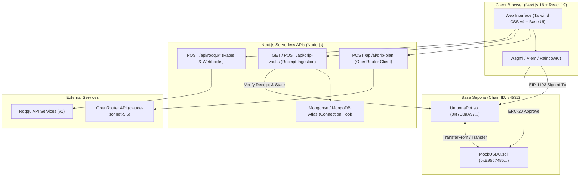

# Umunna Pot

> Programmable community finance, multisignature governed disbursements, and automated income smoothing powered by smart contracts and real-world payment infrastructure.

[](https://nextjs.org/)
[](https://react.dev/)
[](https://tailwindcss.com/)
[](https://www.typescriptlang.org/)
[-0052FF?style=flat-square&logo=coinbase)](https://base.org)
[](https://www.mongodb.com/)
[-purple?style=flat-square)](https://openrouter.ai/)
[](LICENSE)

---

## Table of Contents

- [1. Executive Summary & Current State](#1-executive-summary--current-state)
- [2. Problem Statement & Core Principles](#2-problem-statement--core-principles)
- [3. Core Product Modules](#3-core-product-modules)
  - [Module 1: Community Fund (Pooling)](#module-1-community-fund-pooling)
  - [Module 2: Community Disperse (Multisig Governance)](#module-2-community-disperse-multisig-governance)
  - [Module 3: Freelancer Drip Vault (Self-Payroll Timelocks)](#module-3-freelancer-drip-vault-self-payroll-timelocks)
- [4. AI Schedule Recommendation Engine](#4-ai-schedule-recommendation-engine)
- [5. System Architecture & Workflows](#5-system-architecture--workflows)
- [6. Deployed Smart Contracts & Tokens](#6-deployed-smart-contracts--tokens)
- [7. Technology Stack](#7-technology-stack)
- [8. Repository Structure](#8-repository-structure)
- [9. Getting Started](#9-getting-started)
- [10. Testing & Verification Suites](#10-testing--verification-suites)
- [11. Development Roadmap Status](#11-development-roadmap-status)
- [12. Security, Guardrails & Audit Rules](#12-security-guardrails--audit-rules)
- [13. License](#13-license)

---

## 1. Executive Summary & Current State

**Umunna Pot** is a programmable-money community finance platform engineered to pool communal capital, enforce multi-party disbursement quorums, and automate time-locked payment streams. Rooted in the traditional West African concept of communal stewardship (_Umunna_), the platform replaces informal, error-prone treasury management with transparent, deterministic smart contracts on **Base Sepolia** and real-world payment rails via **Roqqu API Services**.

### 🌟 What The Application Does Right Now (Current State)

As of **Phase 3 Completion**, the Umunna Pot repository is fully functioning and demo-ready:

1. **Active Base Sepolia Deployments:**
   - Interacts live with `UmunnaPot.sol` at `0xf7D0aA978B6Ec7451a87Cc4457f282596a5df738` and `MockUSDC.sol` (`mUSDC`) at `0xE9557485Ccd568c3984451f04f4ceF6E5b63809a`.
2. **Community Pot Creation & Pooling:**
   - Users create on-chain multi-sig pots with customizable M-of-N signature quorums and contribute MockUSDC or simulated NGN via Roqqu.
3. **Multisignature Disbursements:**
   - Signers propose payouts, collect cryptographic approvals on-chain, and execute transfers directly to recipient wallets upon reaching quorum.
4. **Freelancer Drip Vaults (Streaming Payroll):**
   - Funders and freelancers lock income on-chain into automated timelock streams that disburse fixed tranches on a daily, weekly, monthly, or custom interval ($\ge 30\text{s}$) with guardian emergency unlock protection.
5. **AI Schedule Recommendation Engine:**
   - Integrates server-side **OpenRouter (`anthropic/claude-sonnet-5.5`)** via `POST /api/ai/drip-plan` to recommend optimal installment counts and cadences based on milestone scope and budget.
   - Operates under a **Zero-Trust AI Guardrail**: All financial values are strictly calculated in deterministic 6-decimal integer micro-units (`BigInt`). If OpenRouter is offline or rate-limited, the system seamlessly provides deterministic manual fallback without halting vault creation.
6. **Hardened Ingestion & Safe Recovery:**
   - Database writes require confirmed on-chain receipts and event log validation (`VaultCreated`, `VaultReleased`).
   - If an on-chain transaction succeeds but API sync encounters an error, a **Partial-Success Recovery Dialog** preserves the transaction hash and allows one-click database retries **without ever submitting duplicate on-chain transactions**.

---

## 2. Problem Statement & Core Principles

### The Problem
- **Opacity & Single Custodian Risk:** Communal savings groups and informal cooperatives often hold funds in a single treasurer's personal bank account, leading to misappropriation and bookkeeping disputes.
- **Unchecked Disbursements:** Traditional executive councils lack programmatic controls to enforce that funds cannot be spent without verified M-of-N quorum consensus.
- **Freelancer Income Volatility:** Independent gig workers receiving large lump-sum retainers often face cash-flow crises between gigs due to lack of automated, disciplined timelock vaults.

### Core Product Principles
- **Trust through Programmable Verification:** Financial rules, approval thresholds, and release schedules are embedded directly into smart contracts.
- **Zero-Trust AI Custody:** AI assists in recommending schedules, but never holds keys, signs transactions, alters financial calculations, or releases funds.
- **Deterministic Financial Precision:** All token arithmetic is computed in exact integer base units ($1\text{ USDC} = 1{,}000{,}000\text{ micro-units}$) with zero floating-point rounding loss.

---

## 3. Core Product Modules

### Module 1: Community Fund (Pooling)
- Allows organizers to deploy a named communal pot on Base Sepolia.
- Configures authorized signer wallets and M-of-N approval thresholds (e.g., 2-of-3).
- Accepts direct `mUSDC` token deposits or converts NGN fiat deposits using Roqqu exchange rates.

### Module 2: Community Disperse (Multisig Governance)
- Signers draft formal on-chain payout proposals specifying recipient, amount, and milestone description.
- Authorized co-signers approve proposals using their connected Web3 wallets.
- Once quorum threshold is met, any authorized signer can execute the on-chain payout.

### Module 3: Freelancer Drip Vault (Self-Payroll Timelocks)
- Lock lump-sum retainers into an on-chain timelock contract to stream predictable income tranches.
- **Cadences Supported:** Weekly (7 days), Daily (24 hours), Monthly (fixed 30 days = 2,592,000s), and Custom (min. 30 seconds).
- **Guardian Co-Signing:** In genuine emergencies, the beneficiary can request an early unlock, which releases all remaining principal only upon the designated guardian's approval.
- **Automated / Manual Claims:** Beneficiaries claim due installments on-chain via `releaseDue()` once scheduled intervals have elapsed.

---

## 4. AI Schedule Recommendation Engine

The **AI Drip Schedule Assistant** connects users to intelligent payment planning:

```
User Context (Amount, Frequency, Purpose) ──► POST /api/ai/drip-plan
                                                        │
                      ┌─────────────────────────────────┴─────────────────────────────────┐
                      ▼                                                                   ▼
       OpenRouter AI Inference (Claude Sonnet 5.5)                           Deterministic Fallback Engine
      (Advisory cadence & installment selection)                         (Offline / timeout resilient backup)
                      │                                                                   │
                      └─────────────────────────────────┬─────────────────────────────────┘
                                                        ▼
                                     Deterministic Financial Calculator
                                     (lib/dripScheduleCalculator.ts)
                                  • BigInt 6-decimal micro-unit division
                                  • Exact remainder placed in final tranche
                                  • intervalSeconds >= 30 contract compliance
                                                        ▼
                                         Structured Schedule Preview
```

### Security & Financial Guardrails
- **Advisory Role Only:** The AI only suggests cadence and installment count.
- **Deterministic Math:** Integer arithmetic guarantees that $\sum \text{installments} \equiv \text{totalBaseUnits}$.
- **Clear UI Attribution:** The frontend distinctly badges output as **AI Recommended** (with model tag) or **Deterministic Fallback** (with explicit reason).

---

## 5. System Architecture & Workflows

### System Architecture Overview



---

## 6. Deployed Smart Contracts & Tokens

| Contract / Asset | Network | Address | Explorer Link |
| :--- | :--- | :--- | :--- |
| **UmunnaPot** | Base Sepolia (`84532`) | `0xf7D0aA978B6Ec7451a87Cc4457f282596a5df738` | [View on BaseScan](https://sepolia.basescan.org/address/0xf7D0aA978B6Ec7451a87Cc4457f282596a5df738) |
| **MockUSDC (`mUSDC`)** | Base Sepolia (`84532`) | `0xE9557485Ccd568c3984451f04f4ceF6E5b63809a` | [View on BaseScan](https://sepolia.basescan.org/address/0xE9557485Ccd568c3984451f04f4ceF6E5b63809a) |

> [!NOTE]
> All UI screens, forms, and cards explicitly label the token as **`mUSDC` (MockUSDC on Base Sepolia)** to prevent confusing testnet assets with real-value production stablecoins.

---

## 7. Technology Stack

- **Framework:** Next.js `16.4.3` (App Router, Turbopack)
- **Frontend:** React `19.3.1`, Tailwind CSS `v4`, Base UI, shadcn/ui primitives, Lucide icons
- **State & Web3:** Wagmi `v2.19.5`, Viem `v2.57.16`, RainbowKit `v2.2.11`, TanStack React Query `v5.105.3`
- **Database:** MongoDB Atlas with Mongoose `v9.11.4` (serverless connection pooling)
- **AI Inference:** OpenRouter API (`anthropic/claude-sonnet-5.5`)
- **Validation:** Zod `v4.6.7`
- **Smart Contracts:** Solidity `^0.8.20`, Foundry (`forge`)

---

## 8. Repository Structure

```
umunna-pot/
├── app/
│   ├── (app)/
│   │   ├── community-funds/      # Community funds listing & details
│   │   ├── dashboard/            # Treasury overview & live Roqqu rates
│   │   ├── disbursements/        # Multisig quorum proposals & approvals
│   │   └── drip-vault/           # Freelancer Drip Vault frontend
│   ├── api/
│   │   ├── ai/drip-plan/         # Advisory AI schedule engine endpoint
│   │   ├── communities/          # Community pot database endpoints
│   │   ├── drip-vaults/          # Verified on-chain vault receipt ingestion
│   │   └── roqqu/                # Rates, checkout, and webhook handlers
│   ├── layout.tsx                # App root wrapper & Web3Provider
│   └── page.tsx                  # Landing page
├── components/
│   ├── community/                # Community cards, modals, payout dialogs
│   ├── drip/                     # Drip vault cards, modals, AI previews, sync recovery
│   ├── shell/                    # Header, sidebar, navigation
│   └── ui/                       # Base UI & Tailwind primitives (buttons, dialogs, cards)
├── hooks/
│   ├── useCommunityPots.ts       # Community contract hooks
│   ├── useDashboardData.ts       # React Query hooks for treasury metrics
│   ├── useDripVault.ts           # Drip Vault approval, creation, release & sync hooks
│   └── useRoqquRates.ts          # Live NGN/USD valuation hooks
├── lib/
│   ├── aiSchemas.ts              # Zod schemas for AI requests & structured responses
│   ├── contracts.ts              # Contract ABIs, addresses & Base Sepolia constants
│   ├── db.ts                     # MongoDB connection pooling & cache
│   ├── dripAiEngine.ts           # OpenRouter client & fallback implementation
│   ├── dripScheduleCalculator.ts # Deterministic BigInt financial calculator
│   └── dripVaultSync.ts          # Receipt decoding, event extraction & API sync
├── models/
│   ├── Community.ts              # MongoDB model for community funds
│   └── DripVault.ts              # Hardened MongoDB model for verified drip vaults
├── test/
│   ├── dripPlan.api.test.ts      # AI engine & micro-unit precision tests
│   ├── dripVault.api.test.ts     # Ingestion & idempotency API tests
│   ├── dripVault.frontend.test.ts# Frontend input & release logic tests
│   ├── dripVault.sync.test.ts    # Blockchain verification & recovery tests
│   └── dripVault.unit.test.ts    # Topic encoding & safe BigInt tests
├── contracts/                    # Foundry workspace (UmunnaPot.sol, MockUSDC.sol)
├── docs/                         # Audit reports & integration specifications
│   ├── deployment/               # Hosting readiness reports
│   └── phase-3/                  # Phase 3 audit reports & preflight checks
└── next.config.ts                # Next.js configuration & server external packages
```

---

## 9. Getting Started

### Prerequisites
- **Node.js**: `>= 20.18.0`
- **pnpm**: `>= 9.0.0`
- **Git**

### Installation
```bash
git clone https://github.com/Umunna-Pot/umunna-pot.git
cd umunna-pot
pnpm install
```

### Environment Configuration
Copy `.env.example` to `.env.local` and configure your credentials:
```bash
cp .env.example .env.local
```

Key variables to populate:
```bash
# Network & Smart Contracts
NEXT_PUBLIC_BASE_SEPOLIA_RPC_URL="https://sepolia.base.org"
NEXT_PUBLIC_CHAIN_ID="84532"
NEXT_PUBLIC_UMUNNA_POT_ADDRESS="0xf7D0aA978B6Ec7451a87Cc4457f282596a5df738"
NEXT_PUBLIC_MOCK_USDC_ADDRESS="0xE9557485Ccd568c3984451f04f4ceF6E5b63809a"

# Database (MongoDB Atlas)
MONGODB_URI="mongodb+srv://<username>:<password>@cluster.mongodb.net/"
MONGODB_DB="umunna_pot"

# AI Inference (OpenRouter)
OPENROUTER_API_KEY="sk-or-v1-your_openrouter_api_key_here"
OPENROUTER_MODEL="anthropic/claude-sonnet-5.5"
```

### Run Locally
```bash
pnpm dev
```
Navigate to `http://localhost:3000` to launch the application.

---

## 10. Testing & Verification Suites

The repository contains automated unit and integration tests with zero external test runners required:

```bash
# Run complete test suite across all 43 tests
pnpm dlx tsx --env-file=.env.local --test test/*.test.ts

# Run static TypeScript typecheck
pnpm typecheck

# Run production build compilation
pnpm build

# Run code style & linting check
pnpm lint
```

### Test Coverage Highlights
- **43 / 43 tests passing** across 12 suites.
- Exact remainder redistribution and BigInt math verified.
- Event log emitter decoding and contract-state matching verified.
- Concurrency and idempotent synchronization recovery verified.

---

## 11. Development Roadmap Status

```
┌────────────────────────────────────────────────────────────────────────┐
│                        PROJECT ROADMAP STATUS                          │
├─────────┬───────────────────────────────────────────┬──────────────────┤
│ Phase   │ Description                               │ Status           │
├─────────┼───────────────────────────────────────────┼──────────────────┤
│ Phase 1 │ Foundation & Scaffolding                  │ ✅ Completed      │
│ Phase 2 │ Community Finance (Treasury & Multisig)   │ ✅ Completed      │
│ Phase 3 │ Drip Vault & OpenRouter AI Engine         │ ✅ Completed      │
│ Phase 4 │ Hosting Readiness & Pre-Deployment Audit  │ ✅ Completed      │
│ Phase 5 │ Live Demo Presentation & Submission       │ 🚀 Ready          │
└─────────┴───────────────────────────────────────────┴──────────────────┘
```

---

## 12. Security, Guardrails & Audit Rules

1. **Non-Custodial:** Private keys remain exclusively in client browser wallets. Neither the server nor the AI has access to user keys.
2. **On-Chain Enforcement:** Smart contract timelocks (`intervalSeconds >= 30`) and multi-sig quorums cannot be bypassed by frontend or backend state changes.
3. **Receipt-Derived Storage:** MongoDB documents are inserted only after an on-chain transaction receipt is fetched from Base Sepolia and cryptographically verified.
4. **Idempotent Recovery:** Safe retries prevent duplicate on-chain transactions if database network calls time out.

---

## 13. License

Distributed under the [MIT License](LICENSE).

---

_Built with communal stewardship for the Umunna Pot community finance ecosystem._
