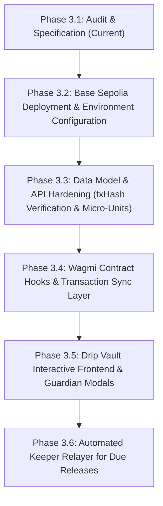

# Umunna Pot: Phase 3 Drip Vault Contract & Application Integration Specification

**Document Version:** 1.0.0  
**Status:** AUDITED / SPECIFIED  
**Network Target:** Base Sepolia (Chain ID: 84532)  
**Primary Contracts:** `UmunnaPot.sol`, `MockUSDC.sol`  

---

## A. Existing Implementation Overview

The **Umunna Pot** application integrates community-based micro-treasury pooling with a self-discipline **Freelancer Drip Vault** on Base Sepolia.

### 1. Smart Contract Layer (`contracts/src/UmunnaPot.sol`)
The smart contract codebase employs a unified monolith architecture where both the multi-signature group treasury and the individual freelancer drip vaults reside within `UmunnaPot.sol`.
- **Inheritance & Safety:** Inherits OpenZeppelin v5 `ReentrancyGuard`, utilizes `SafeERC20` for all token transfers.
- **Token Dependency:** Interacts with an immutable ERC-20 token interface (`IERC20 public immutable usdc`), configured at constructor deployment time with 6 decimal places (Base Sepolia standard).
- **Dual Functionality:**
  - *Group Treasury:* Multi-sig quorum creation, contributions, and payout proposals.
  - *Drip Vault:* Non-custodial, time-locked recurring disbursements for gig workers, freelancers, or personal budget allocation with guardian co-signing for emergency early exits.

### 2. Contract ABI & Client Bindings (`lib/contracts.ts`)
- Contains full typed ABI definitions for `UMUNNA_POT_ABI` and `MOCK_USDC_ABI`.
- Exports functions for:
  - `createDripVault(uint256,uint256,uint64,uint64,address,address)`
  - `releaseDue(uint256)`
  - `requestEarlyExit(uint256)`
  - `approveEarlyExit(uint256)`
  - `getDripVault(uint256)`
  - `getUserVaultIds(address)`
  - `getDueVaultIds()`
- Includes deployment validation helper `isContractConfigured()`.

### 3. Test Coverage (`contracts/test/DripVault.t.sol`)
Foundry test suite defines end-to-end unit tests covering:
- Early release rejection (`ReleaseNotDue`).
- Installment release execution (`releaseDue`) across full schedule.
- Complete schedule exhaustion (`v.active == false`, `v.remainingAmount == 0`).
- Guardian unauthorized early exit rejection (`EarlyExitNotRequested`).
- Non-beneficiary early exit request rejection (`NotBeneficiary`).
- Complete emergency unlock and token refund flow (`approveEarlyExit`).

---

## B. Verified Contract Functions, Structs, Errors & Events

### 1. State Struct: `DripVault`
```solidity
struct DripVault {
    address funder;             // Creator/funder of the vault
    address beneficiary;        // Recipient of released drip installments
    address guardian;           // Designated emergency co-signer
    uint256 totalAmount;        // Initial total locked USDC (base units: 1e6)
    uint256 remainingAmount;    // Current unreleased USDC balance
    uint256 installmentAmount;  // Fixed disbursement per interval
    uint64 intervalSeconds;     // Time cadence between releases (>= 30s)
    uint64 nextReleaseAt;       // Unix epoch timestamp of next due release
    uint32 releasedCount;       // Number of disbursements executed so far
    bool active;                // True while remainingAmount > 0 and not exited
    bool earlyExitRequested;    // True when beneficiary has submitted emergency request
    bool exists;                // Existence guard for storage lookups
}
```

### 2. Verified Functions

| Function Signature | Visibility | Modifiers | Description |
| :--- | :--- | :--- | :--- |
| `createDripVault(uint256 totalAmount, uint256 installmentAmount, uint64 intervalSeconds, uint64 firstReleaseAt, address beneficiary, address guardian)` | `external` | `nonReentrant` | Transfers `totalAmount` USDC from caller, indexes vault by caller, beneficiary, and guardian. Returns `vaultId`. |
| `releaseDue(uint256 vaultId)` | `external` | `nonReentrant` | Releases `min(remainingAmount, installmentAmount)` to `beneficiary`. Can be triggered by **any caller** (keeper, beneficiary, funder). |
| `requestEarlyExit(uint256 vaultId)` | `external` | None | Initiates emergency exit. Caller **must** be `v.beneficiary`. |
| `approveEarlyExit(uint256 vaultId)` | `external` | `nonReentrant` | Finalizes exit and sends all remaining tokens to `beneficiary`. Caller **must** be `v.guardian`. |
| `getDripVault(uint256 vaultId)` | `external view` | None | Returns complete `DripVault` struct. |
| `getUserVaultIds(address account)` | `external view` | None | Returns array of `vaultId`s where `account` is funder, beneficiary, or guardian. |
| `getDueVaultIds()` | `external view` | None | Iterates `1..vaultCount` and returns all active vaults where `block.timestamp >= nextReleaseAt`. Useful for autonomous keeper sweeps. |

### 3. Events Emitted
- `VaultCreated(uint256 indexed vaultId, address indexed funder, address indexed beneficiary, address guardian, uint256 totalAmount, uint256 installmentAmount, uint64 intervalSeconds, uint64 firstReleaseAt)`
- `VaultReleased(uint256 indexed vaultId, address indexed beneficiary, uint256 amount, uint256 remainingAmount)`
- `EarlyExitRequested(uint256 indexed vaultId, address indexed beneficiary)`
- `EarlyExitApproved(uint256 indexed vaultId, address indexed beneficiary, address indexed guardian, uint256 refundedAmount)`

### 4. Failure Conditions & Custom Errors
- `InvalidSchedule()`: Thrown when `totalAmount == 0`, `installmentAmount == 0`, `installmentAmount > totalAmount`, `intervalSeconds < 30`, or `firstReleaseAt < block.timestamp`.
- `InvalidParticipants()`: Thrown if `beneficiary == address(0)`, `guardian == address(0)`, or `beneficiary == guardian`.
- `VaultNotFound()`: Thrown if `vaultId == 0` or `vaultId > vaultCount`.
- `VaultInactive()`: Thrown when attempting to operate on a closed or fully drained vault (`v.active == false`).
- `ReleaseNotDue(uint64 currentTimestamp, uint64 nextReleaseAt)`: Thrown when `block.timestamp < v.nextReleaseAt`.
- `NotBeneficiary()`: Thrown if caller of `requestEarlyExit` is not `v.beneficiary`.
- `NotGuardian()`: Thrown if caller of `approveEarlyExit` is not `v.guardian`.
- `EarlyExitNotRequested()`: Thrown if guardian calls `approveEarlyExit` before beneficiary requested it.

---

## C. Deployment Verification Status

> [!NOTE]
> **DEPLOYMENT STATUS: VERIFIED & ACTIVE ON BASE SEPOLIA**
>
> Automated read-only RPC diagnostics conducted via `https://sepolia.base.org` returned:
> - **Target Chain:** Base Sepolia (Chain ID: `84532`, RPC: `https://sepolia.base.org`)
> - **Chain ID Verified:** Yes (Current block height: `54,809,000+`)
> - **Configured `UMUNNA_POT_CONTRACT_ADDRESS`:** `0xf7D0aA978B6Ec7451a87Cc4457f282596a5df738`
>   - **Bytecode Verified:** Yes (`22,972` bytes)
>   - **On-chain State:** `communityCount = 5`, `vaultCount = 0`, `usdc = 0xE9557485Ccd568c3984451f04f4ceF6E5b63809a`
>   - **USDC Collateral Held:** `2,110.90 USDC` (`2,110,900,000` base units)
> - **Configured `NEXT_PUBLIC_MOCK_USDC_ADDRESS`:** `0xE9557485Ccd568c3984451f04f4ceF6E5b63809a`
>   - **Bytecode Verified:** Yes (`3,884` bytes)
>   - **Symbol / Decimals:** `mUSDC` / `6` decimals
> - **Relayer Private Key:** Configured on server (`RELAYER_PRIVATE_KEY`)
> - **Database:** Connected to MongoDB Atlas (`umunna_pot`), matching active on-chain communities.

---

## D. Existing API Routes and Database Models

### 1. MongoDB Model (`models/DripVault.ts`)
```typescript
export interface IDripVault extends Document {
  onChainVaultId: number
  freelancerAddress: string
  beneficiaryAddress: string
  guardianAddress: string
  totalLockedUsdc: number
  installmentAmountUsdc: number
  intervalSeconds: number
  claimedUsdc: number
  remainingUsdc: number
  nextReleaseAt: Date
  status: "streaming" | "completed" | "emergency_unlocked"
  createdAt: Date
  updatedAt: Date
}
```

### 2. API Route (`app/api/drip-vaults/route.ts`)
- **`GET /api/drip-vaults?address=0x...`**:
  - Connects to MongoDB Atlas via `dbConnect()`.
  - Filters vaults matching `freelancerAddress`, `beneficiaryAddress`, or `guardianAddress`.
  - **Fallback / Seed behavior:** If the database contains no vaults, it auto-inserts a dummy record (`SEED_VAULTS` with synthetic `onChainVaultId: 0`).
- **`POST /api/drip-vaults`**:
  - Accepts JSON payload with `freelancerAddress`, `guardianAddress`, `totalLockedUsdc`, `installmentAmountUsdc`, `intervalSeconds`.
  - Calculates synthetic `onChainVaultId = await DripVault.countDocuments()`.
  - **Major Architectural Gap:** Does **not** accept or verify an on-chain transaction hash, does not verify on-chain events, and does not require contract confirmation before persisting records.

---

## E. Existing Frontend Integration & Gaps

### Current Status (`app/(app)/drip-vault/page.tsx`)
- The current page is a static marketing / teaser dashboard consisting of two UI cards:
  1. *Scheduled Installments* (descriptive text).
  2. *Guardian Emergency Co-Sign* (descriptive text).
- **Missing UI Components:**
  - No wallet connection check or prompt.
  - No "Create Drip Vault" form or modal.
  - No active stream visualization (progress bar, total streamed vs. locked, countdown timer to next release).
  - No "Claim Release" / "Trigger Release" interaction button.
  - No "Request Early Exit" action for beneficiaries.
  - No "Approve Early Exit" co-signing modal for guardians.

---

## F. Missing Integration Requirements for Phase 3

To achieve a production-grade MVP, the following integration modules must be built:

1. **Wagmi Hook Wrappers (`hooks/useDripVault.ts`):**
   - Read hooks: `useReadContract` for `getDripVault`, `getUserVaultIds`, and `getDueVaultIds`.
   - Write hooks: `useWriteContract` for `createDripVault`, `releaseDue`, `requestEarlyExit`, and `approveEarlyExit`.
   - Pre-transaction ERC-20 approval check and prompt (`MockUSDC.approve(potAddress, totalAmount)`).
2. **On-Chain Transaction Synchronizer (`lib/dripVaultSync.ts`):**
   - When a user submits `createDripVault` on-chain, read the parsed log `VaultCreated` from the transaction receipt to retrieve the real `vaultId`.
   - Post to `/api/drip-vaults` with the verified `txHash` and `onChainVaultId`.
3. **Autonomous Keeper Bot / Relayer Endpoint (`app/api/drip-vaults/keeper/route.ts`):**
   - Provide an authenticated cron or background endpoint that calls `pot.getDueVaultIds()`.
   - Uses the server relayer key (`lib/relayer.ts`) to execute `releaseDue(vaultId)` when releases are due, relieving users from manual claiming.
4. **Interactive Dashboard UI (`components/drip/`):**
   - `CreateVaultModal.tsx`: Inputs for total amount, installment size, interval selection (demo 60s vs. daily/weekly), and guardian address.
   - `VaultCard.tsx`: Visual breakdown showing remaining balance, claimed percentage, countdown timer, and action buttons.
   - `EmergencyExitDialog.tsx`: Distinct state controls for beneficiary request and guardian approval.

---

## G. Security, Concurrency & Financial Integrity Analysis

### 1. Integer Precision & Floating-Point Drift
- **Contract Standard:** All token amounts in `UmunnaPot.sol` are `uint256` in base units (6 decimals for USDC, where \$1.00 = `1_000_000`).
- **Database Weakness:** `models/DripVault.ts` defines `totalLockedUsdc: { type: Number }`. In JavaScript, large floating-point numbers can lose precision.
- **Remediation:** Store amounts in the database as strings or fixed integer micro-units (`totalLockedBaseUnits: string`), and utilize `lib/format.ts` (`formatUsdc` and `parseUsdc`) for conversions.

### 2. Unverified Off-Chain Record Creation
- **Current Vulnerability:** `POST /api/drip-vaults` allows any HTTP client to create arbitrary vault records with synthetic IDs without locking any collateral on Base Sepolia.
- **Remediation:** `POST /api/drip-vaults` must mandate a `txHash`. The server must fetch the receipt via Viem `publicClient.getTransactionReceipt({ hash })`, parse the `VaultCreated` event, and confirm the log matches the database fields.

### 3. Missed Release Catch-Up Semantics
- **Contract Behavior:** If an active vault is scheduled for release every 60 seconds, but 300 seconds elapse before `releaseDue` is triggered:
  - Line 359 of `UmunnaPot.sol` executes: `v.nextReleaseAt += v.intervalSeconds;`
  - It dispenses **one installment** and shifts the timestamp forward by 60 seconds (not to `block.timestamp`).
  - *Result:* The vault remains immediately due (`block.timestamp >= nextReleaseAt`). The keeper or caller can immediately invoke `releaseDue` again in subsequent transactions until fully caught up. This protects beneficiaries from bulk payout draining while ensuring all scheduled funds remain accessible.

---

## H. Recommended Implementation Order



1. **Phase 3.2 — Contract Deployment & Verification:** Deploy `MockUSDC` and `UmunnaPot` on Base Sepolia, verify bytecode on-chain, update `.env.local` addresses.
2. **Phase 3.3 — Database & API Hardening:** Upgrade `models/DripVault.ts` to store integer base units and link each record to verified transaction receipts.
3. **Phase 3.4 — Contract Hooks & Integration:** Build `hooks/useDripVault.ts` with allowance handling and receipt log decoding.
4. **Phase 3.5 — Frontend Implementation:** Replace placeholder card in `app/(app)/drip-vault/page.tsx` with full interactive dashboard.
5. **Phase 3.6 — Keeper Relayer Automation:** Connect `lib/relayer.ts` to sweep `getDueVaultIds()` periodically.

---

## I. Exact File Modification Matrix for Subsequent Tasks

| File Path | Task Phase | Nature of Change |
| :--- | :--- | :--- |
| `.env.local` | Phase 3.2 | Update `NEXT_PUBLIC_UMUNNA_POT_ADDRESS` and `NEXT_PUBLIC_MOCK_USDC_ADDRESS` with verified deployed addresses. |
| `models/DripVault.ts` | Phase 3.3 | Add `txHash`, change numeric financial fields to integer base units or string representations. |
| `app/api/drip-vaults/route.ts` | Phase 3.3 | Enforce transaction receipt validation using Viem `publicClient`. Deprecate synthetic seed vaults. |
| `hooks/useDripVault.ts` (New) | Phase 3.4 | Custom Wagmi hook wrapping vault queries and contract mutations with approval prompts. |
| `components/drip/CreateVaultModal.tsx` (New) | Phase 3.5 | Modal for scheduling new vaults with interval and guardian selection. |
| `components/drip/VaultCard.tsx` (New) | Phase 3.5 | Card displaying active vault metrics, countdown, claim button, and exit request. |
| `app/(app)/drip-vault/page.tsx` | Phase 3.5 | Connect live Wagmi hooks and MongoDB query to render real user vaults. |
| `app/api/drip-vaults/keeper/route.ts` (New) | Phase 3.6 | Serverless trigger endpoint calling `releaseDue` on all `dueVaultIds`. |

---

## J. MVP Blockers vs. Deferrable Optimizations

### Critical MVP Blockers (Must Fix in Phase 3.2 - 3.5)
1. **Contract Deployment:** Real contract must be deployed on Base Sepolia; zero-address placeholder will revert any user transaction.
2. **ERC-20 Allowance Flow:** Frontend must implement token approval before calling `createDripVault`, or transactions will fail with ERC-20 transfer errors.
3. **Receipt-Grounded Persistence:** Database must never insert synthetic or unconfirmed vaults.
4. **Interactive Dashboard:** Users must be able to view their vaults and trigger due releases directly from the UI.

### Deferrable Enhancements (Post-MVP / Phase 4)
1. **Gasless Keeper Subsidy (ERC-4337 / Paymaster):** Requiring an automated keeper to pay gas for every release can be subsidized by the user calling `releaseDue()` themselves during early testing.
2. **Streaming Graphs (Superfluid-style animation):** Continuous per-second visual counter can be deferred in favor of clear interval countdown timers.
3. **Multiple Guardians / Multi-sig Exit:** Current single guardian architecture is sufficient for Phase 3.
