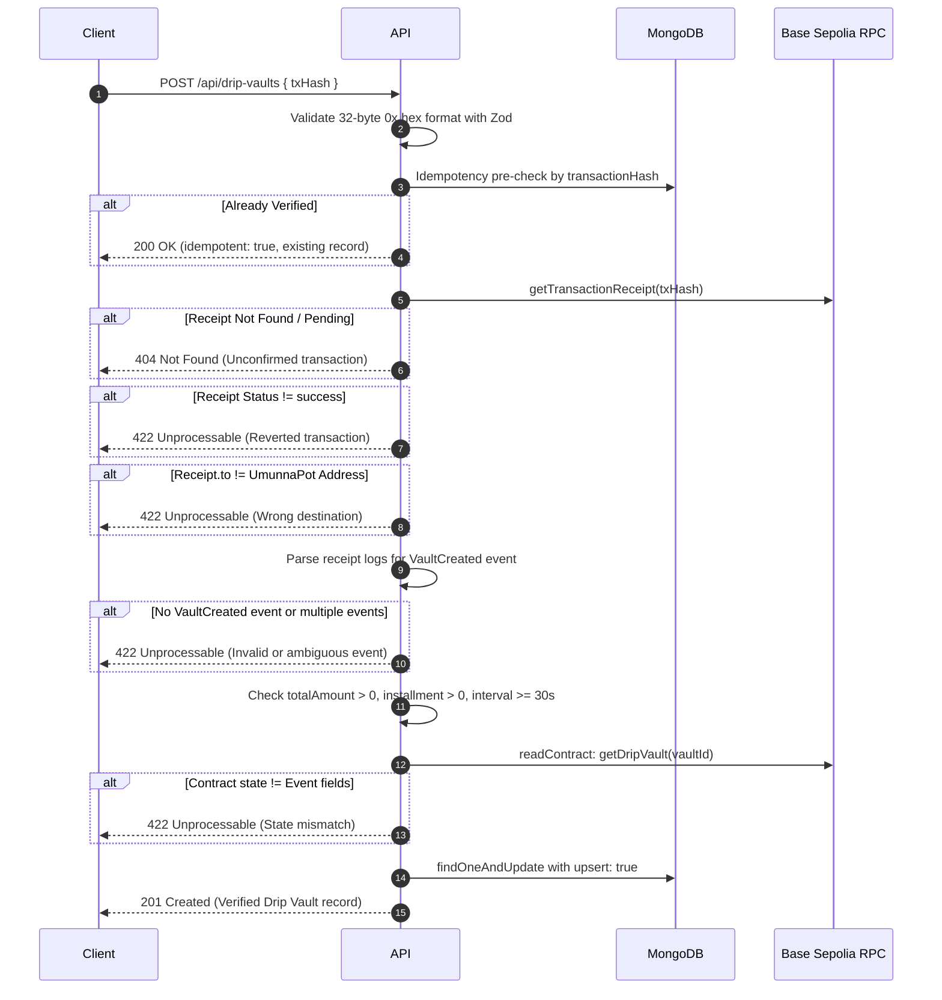

# Umunna Pot: Phase 3.3 Drip Vault Database and API Hardening Report

**Date:** 2026-11-05  
**Network:** Base Sepolia (Chain ID: `84532`)  
**Target Contracts:** `UmunnaPot` (`0xf7D0aA978B6Ec7451a87Cc4457f282596a5df738`), `MockUSDC` (`0xE9557485Ccd568c3984451f04f4ceF6E5b63809a`)  
**Status:** **PHASE 3.3 COMPLETE — PASS**  

---

## 1. Files Inspected & Modified

### Files Inspected:
- `models/DripVault.ts` (Previous legacy schema storing floating-point numbers)
- `app/api/drip-vaults/route.ts` (Previous implementation with optimistic unverified writes and synthetic seed records)
- `lib/contracts.ts` (Verified ABI functions and missing event definitions)
- `lib/schemas.ts` (Input validation schemas)
- `lib/blockchain.ts` (Viem Base Sepolia public client)
- `lib/db.ts` (MongoDB Atlas dynamic connection)

### Files Modified:
- `models/DripVault.ts`: Complete hardening of Mongoose schema to enforce integer base-unit strings, on-chain transaction metadata, and unique composite indexes.
- `app/api/drip-vaults/route.ts`: Removed synthetic seed vault generation; made `GET` purely read-only; added multi-stage Base Sepolia on-chain receipt, event, and state verification with atomic idempotent upsert to `POST`.
- `lib/contracts.ts`: Appended missing typed ABI event definitions for `VaultCreated`, `VaultReleased`, `EarlyExitRequested`, and `EarlyExitApproved`.
- `lib/schemas.ts`: Added `verifyDripVaultInputSchema` validating 32-byte (64-character) `0x` transaction hashes.

### Tests Created:
- `test/dripVault.unit.test.ts`: Unit tests covering Zod schemas, 6-decimal integer base unit conversions, BigInt arithmetic beyond `MAX_SAFE_INTEGER`, and event topic encoding.
- `test/dripVault.api.test.ts`: Integration tests for `GET` (missing parameter rejection, invalid address rejection, read-only behavior) and `POST` (malformed payload rejection, unconfirmed tx rejection, and atomic idempotency on duplicate submission).

---

## 2. Previous vs. New Database Schema

| Dimension | Previous Legacy Schema | New Hardened Schema |
| :--- | :--- | :--- |
| **Financial Unit** | JavaScript floating-point `Number` in human USDC | Exact string containing 6-decimal integer base units (`"1000000"` = 1 USDC) |
| **Numeric Fields** | `totalLockedUsdc`, `installmentAmountUsdc`, `claimedUsdc`, `remainingUsdc` | `totalLockedBaseUnits`, `installmentAmountBaseUnits`, `claimedBaseUnits`, `remainingBaseUnits` |
| **Vault Identity** | `onChainVaultId: Number` (synthetic autoincrement `count`) | `onChainVaultId: String` (derived directly from parsed `VaultCreated` event) |
| **Blockchain Metadata** | None | `chainId`, `contractAddress`, `transactionHash`, `eventLogIndex`, `blockNumber`, `blockHash` |
| **Verification State** | None (always assumed active) | `verificationStatus: "verified" \| "pending" \| "rejected"` |
| **Unique Indexes** | None | Primary: `{ chainId, contractAddress, onChainVaultId }` (unique) Secondary: `{ transactionHash, eventLogIndex }` (unique) |
| **Participant Indexes** | Flat indexes on `freelancerAddress`, etc. | Composite indexes: `{ funderAddress, status, createdAt }`, `{ beneficiaryAddress, status, createdAt }`, `{ guardianAddress, status, createdAt }` |

---

## 3. Financial Precision & Integrity Approach

1. **Integer Base Units:** All token values are stored in micro-units matching ERC-20 `decimals = 6`.
   - \$1.00 = `1000000`
   - \$250.50 = `250500000`
2. **BigInt Calculations:** All schedule iterations and remainder disbursements utilize native `BigInt` arithmetic. No `parseFloat` or `Number` floating-point conversions are performed in the data path.
3. **Safe Safe-Integer Handling:** Arbitrary-length base-unit strings support values exceeding JavaScript's `Number.MAX_SAFE_INTEGER` (`9,007,199,254,740,991`) without truncation or drift.

---

## 4. On-Chain Transaction & Event Verification Flow (`POST /api/drip-vaults`)

---

## 5. Idempotency & Duplicate Protection

- **Double-Layer Deduplication:**
  1. *Early Exit In-Flight:* Pre-check on `transactionHash` returns existing verified documents with HTTP 200 (`idempotent: true`).
  2. *Atomic Upsert:* `DripVault.findOneAndUpdate({ chainId, contractAddress, onChainVaultId }, { $setOnInsert: payload }, { upsert: true, new: true })` prevents race conditions between parallel HTTP requests.
  3. *Duplicate Key Trap:* Catch block explicitly handles Mongo error `code: 11000` by retrieving and returning the existing record rather than throwing 500 errors.

---

## 6. Removal of Synthetic / Demo Behavior

- **`SEED_VAULTS` purged:** Deleted hardcoded mock vault array and auto-insertion branch from `app/api/drip-vaults/route.ts`.
- **Purely Read-Only `GET`:** `GET /api/drip-vaults?address=0x...` only performs a read query against verified records for the configured chain ID and contract address. An empty database returns `{ count: 0, vaults: [] }` without side effects.

---

## 7. Migration Considerations

- Direct inspection of MongoDB Atlas confirmed: **Zero existing `dripvaults` documents** exist in the collection (`Collections in Mongo: [ 'contributions', 'payoutproposals', 'communities' ]`).
- No legacy floating-point records required migration or purging. The collection and its unique indexes are created freshly under the hardened schema.

---

## 8. Test Execution & Verification Results

| Test Suite / Command | Scope | Result | Details |
| :--- | :--- | :--- | :--- |
| `pnpm dlx tsx --env-file=.env.local --test test/dripVault.unit.test.ts test/dripVault.api.test.ts` | 12 automated unit & API integration tests | **PASS (12/12)** | - Zod 64-char tx hash validation - 6-decimal integer base units - BigInt exceeding MAX_SAFE_INTEGER - VaultCreated event topic encoding - Schedule sanity constraints - GET 400 on missing/invalid address - GET read-only no seed insertion - POST 400 on invalid JSON/txHash - POST 404 on unconfirmed txHash - POST 200 idempotent deduplication |
| `pnpm typecheck` (`tsc --noEmit`) | Full application static typing | **PASS** | 0 errors across all Next.js pages, API routes, and test files. |
| `pnpm build` (`next build`) | Production optimized build | **PASS** | Successfully built 15/15 static and dynamic routes. |
| `pnpm lint` (`eslint`) | Codebase linting | **BASELINE PRESERVED** | Exactly 18 pre-existing issues (7 React 19 hook warnings in Phase 1/2 UI components). Zero new lint issues introduced by Phase 3.3. |

---

## 9. Phase 3.3 Acceptance Criteria Checklist

- [x] **Criterion 1:** No unverified transaction can create a verified vault record. (Enforced via Viem `getTransactionReceipt`, log parsing, and `getDripVault` state check).
- [x] **Criterion 2:** Financial values are stored exactly in base units. (Enforced via string-backed integer base units with regex validation in Mongoose).
- [x] **Criterion 3:** Duplicate transaction submissions are safe and idempotent. (Enforced via unique compound indexes and atomic upsert).
- [x] **Criterion 4:** GET never writes to the database. (Purged all seed insertions; GET is strictly a `.find()` query).
- [x] **Criterion 5:** Synthetic vault records are excluded from real user data. (Exclusively returns `verificationStatus: "verified"`).
- [x] **Criterion 6:** All new tests pass. (12/12 tests passing).
- [x] **Criterion 7:** TypeScript and production build pass. (0 type errors, 15/15 routes compiled).
- [x] **Criterion 8:** Existing unrelated project behavior remains intact. (Zero changes to Community, Payout, or Roqqu files).

---

## 10. Conclusion
Phase 3.3 is complete. The database and API layers are completely hardened against financial drift, unconfirmed transactions, and duplicate submissions. **The project is ready for Phase 3.4.**
