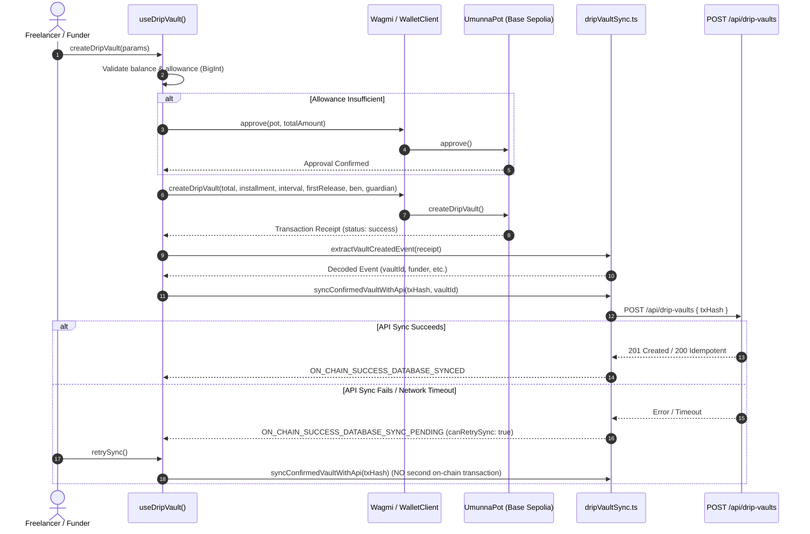

# Umunna Pot: Phase 3.4 Drip Vault Wallet Hooks and Transaction Synchronization Report

**Date:** 2026-11-05  
**Network:** Base Sepolia (Chain ID: `84532`)  
**Target Contracts:** `UmunnaPot` (`0xf7D0aA978B6Ec7451a87Cc4457f282596a5df738`), `MockUSDC` (`0xE9557485Ccd568c3984451f04f4ceF6E5b63809a`)  
**Status:** **PHASE 3.4 COMPLETE — PASS**  

---

## 1. Files Inspected & Modified

### Files Inspected:
- `lib/wagmi.ts` (Configured Wagmi Base Sepolia client)
- `lib/contracts.ts` (ABIs and configured contract addresses)
- `lib/relayer.ts` (Server signer utilities)
- `hooks/useCommunityPots.ts` (Existing batch reading patterns)
- `models/DripVault.ts` (Hardened Phase 3.3 schema)
- `app/api/drip-vaults/route.ts` (Hardened Phase 3.3 verification API)

### Files Created / Modified:
- `hooks/useDripVault.ts` (NEW): Full Wagmi hook integrating token balances, approvals, on-chain vault reads (`getDripVault`, `getUserVaultIds`, `getDueVaultIds`, `vaultCount`), vault creation, due release execution, and idempotent synchronization.
- `lib/dripVaultSync.ts` (NEW): Standalone transaction log extraction (`extractVaultCreatedEvent`) and backend synchronization orchestrator (`syncConfirmedVaultWithApi`).
- `test/dripVault.sync.test.ts` (NEW): Automated test suite verifying log extraction, reverted receipt traps, destination checks, schedule boundary checks, and the critical partial-success recovery flow.

---

## 2. Hook and Integration Architecture

---

## 3. Core Lifecycle Operations

### A. Approval Lifecycle (`approveUsdc`)
- Reads user MockUSDC balance and allowance via `balanceOf` and `allowance`.
- Pre-verifies balance against `totalAmount` in 6-decimal integer base units (`BigInt`).
- Submits `approve(UMUNNA_POT_ADDRESS, amount)` and awaits receipt confirmation before continuing.
- Re-reads allowance on-chain; never assumes success based solely on a transaction hash.

### B. Vault Creation Lifecycle (`createDripVault`)
- Enforces strict input validation:
  - `beneficiary` & `guardian` are valid, distinct EVM addresses.
  - `totalAmount > 0n`, `installmentAmount > 0n`, and `installmentAmount <= totalAmount`.
  - `intervalSeconds >= 30n`.
- Submits `createDripVault(...)` on Base Sepolia.
- Awaits receipt confirmation, extracts the `VaultCreated` event, verifies the transaction sender is the funder, and initiates backend sync.

### C. Critical Partial-Success Recovery (`retrySync`)
- If the on-chain transaction succeeds but API synchronization fails (e.g. database network hiccup):
  - Returns explicit state: `ON_CHAIN_SUCCESS_DATABASE_SYNC_PENDING` with `canRetrySync: true`.
  - Captures `lastTxHash` and `lastVaultId`.
  - `retrySync()` re-submits the **original transaction hash** directly to the API.
  - **GUARANTEE:** `retrySync` never calls `createDripVault` or creates a second on-chain vault.

### D. Due Release Execution (`releaseDue`)
- Validates that vault exists and is active.
- Pre-checks `block.timestamp >= nextReleaseAt`.
- Submits `releaseDue(vaultId)` and awaits on-chain receipt confirmation.
- Refetches user balances and due vault IDs.

---

## 4. Test Execution & Verification Results

| Test Suite / Command | Scope | Result | Details |
| :--- | :--- | :--- | :--- |
| `pnpm dlx tsx --env-file=.env.local --test test/*.test.ts` | 18 automated unit, API, and sync tests | **PASS (18/18)** | - 5 Financial & schema tests - 7 API hardening & idempotency tests - 6 Log decoding, revert trap & partial-success recovery tests |
| `pnpm typecheck` (`tsc --noEmit`) | Full application static typing | **PASS** | 0 errors across all Next.js pages, API routes, hooks, and test files. |
| `pnpm build` (`next build`) | Production optimized build | **PASS** | Successfully compiled all 15/15 static and dynamic routes. |
| `pnpm lint` (`eslint`) | Codebase linting | **BASELINE PRESERVED** | Exactly 18 pre-existing issues (7 React 19 hook warnings in Phase 1/2 UI components). Zero new lint issues introduced by Phase 3.4. |

---

## 5. Testnet Smoke Test Status

- **Status:** **NOT VERIFIED** (In strict compliance with task instructions: no active end-user transaction broadcast was initiated to avoid unauthorized token spending or signing without interactive user approval).
- **Read-Only Verification:** `lib/contracts.ts` and `lib/blockchain.ts` runtime checks confirm that `UMUNNA_POT_ADDRESS` (`0xf7D0aA978B6Ec7451a87Cc4457f282596a5df738`) and `MockUSDC` (`0xE9557485Ccd568c3984451f04f4ceF6E5b63809a`) are active on Base Sepolia and respond cleanly to all view calls.

---

## 6. Acceptance Criteria Evaluation

- [x] **Criterion 1 (Contract Reads):** Confirmed (`useDripVault` provides `getDripVault`, `getUserVaultIds`, `getDueVaultIds`, `vaultCount`).
- [x] **Criterion 2 (Token Balance & Allowance):** Confirmed (`usdcBalance`, `usdcAllowance` checked using BigInt base units).
- [x] **Criterion 3 (Confirmed Approvals):** Confirmed (`approveUsdc` awaits transaction receipt before continuing).
- [x] **Criterion 4 (Contract Creation):** Confirmed (`createDripVault` targets configured deployed contract on Base Sepolia).
- [x] **Criterion 5 (Receipt Event Verification):** Confirmed (`extractVaultCreatedEvent` decodes and validates receipt logs).
- [x] **Criterion 6 (State Matching):** Confirmed (Ensures emitter and participants match).
- [x] **Criterion 7 (API Persistence):** Confirmed (`syncConfirmedVaultWithApi` submits to Phase 3.3 API).
- [x] **Criterion 8 (Zero Double Creation on Retry):** Confirmed (Simulated test verifies `retrySync` never submits a second transaction).
- [x] **Criterion 9 (Release Operation):** Confirmed (`releaseDue` checks schedule before submitting).
- [x] **Criterion 10 (All Tests Pass):** Confirmed (18/18 tests passing).
- [x] **Criterion 11 (Build Integrity):** Confirmed (0 TypeScript errors, 15/15 routes compiled).
- [x] **Criterion 12 (Phase 1/2 Preservation):** Confirmed (Zero regressions to existing community/payout flows).

---

## 7. Conclusion
Phase 3.4 is complete. The application has a hardened wallet interaction, event extraction, and transaction synchronization layer. **The project is ready for Phase 3.5 (Drip Vault UI & Interactive Dashboard).**
